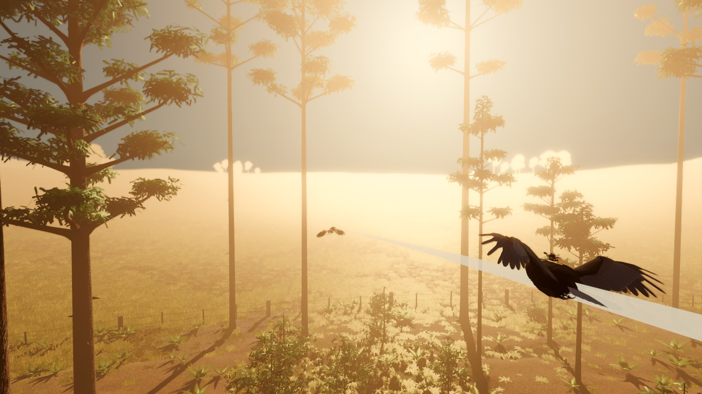
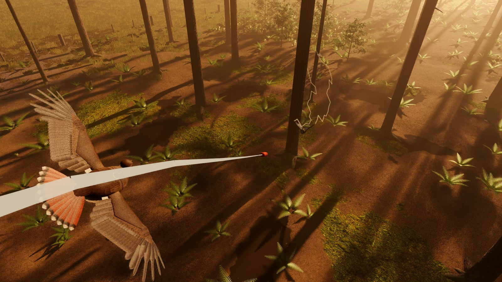
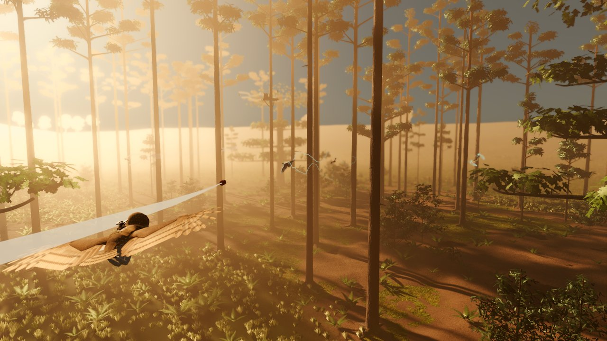
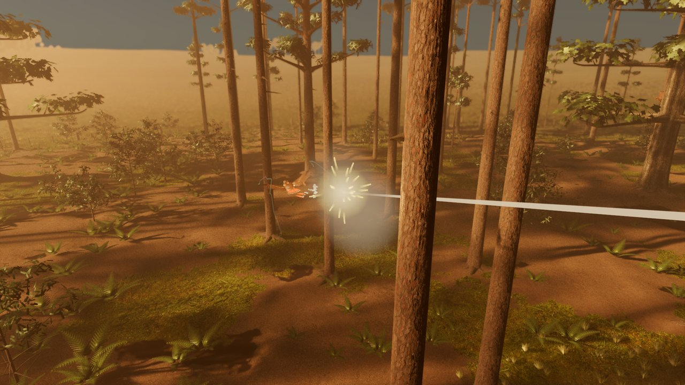
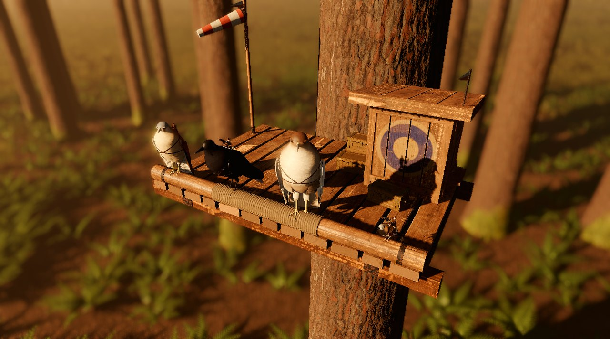
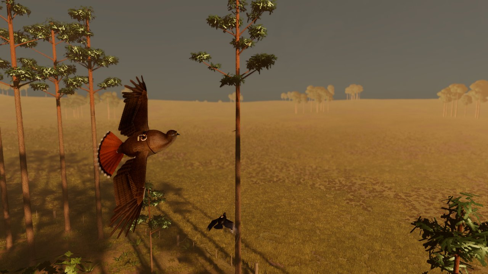
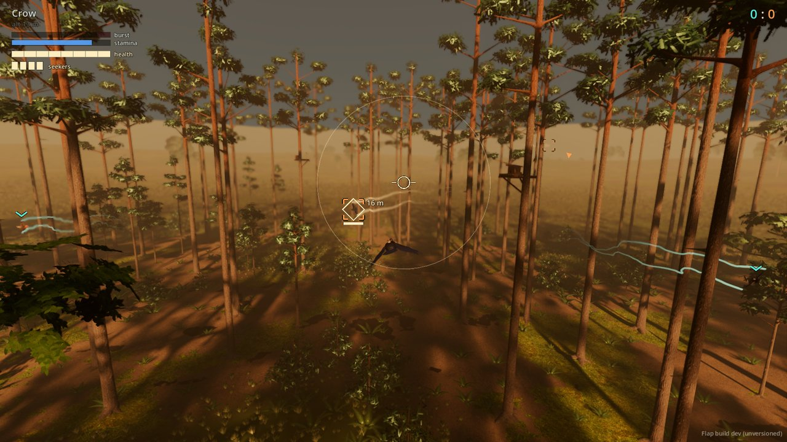
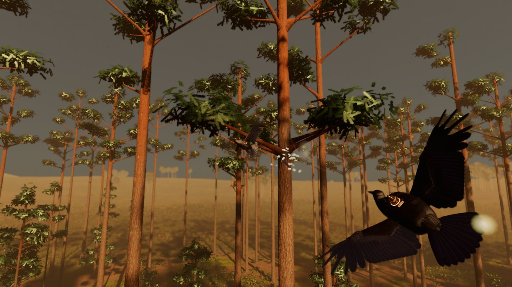

# Flap



**Flap is a bird flight combat game.** You fly a war bird (crow, owl, hawk, falcon or sparrow) with a tiny rider in
the saddle and a weapon pod each side of them, through a sunlit pinewood of tall trunks, clearings and plank
outposts up in the trees. The birds really fly: lift, drag, stalls and stamina come from each species' wings and
muscles, so height is speed, gliding is free, and landing on a branch is a skill. Built in Godot 4.7; Windows.

## Get it and play

You need the source and Godot 4.7 (`Godot_v4.7-stable_win64_console.exe`):

```powershell
git clone https://github.com/afaucher/flap.git
cd flap
$env:FLAP_GODOT = "C:\path\to\Godot_v4.7-stable_win64_console.exe"
.\run.ps1
```

`.\run.ps1` with nothing after it opens the menu. A gamepad is the best way to fly (its left stick has a real
centre); mouse and keyboard work too.

## The menu

- **Flight**: just flying. Pick a bird and how it flies, then explore the wood, ride the thermals, practise landing.
  No riders, no weapons.
- **Fight**: pick your bird, what each of its two pods carries, how it flies, and the mode:
  - **3 v 3 match**: you and two AI wingmen (teal) against three AI birds (warm), each side out from its own outpost.
    The AI comes at **recruit**, **pilot** or **ace** skill. The score (top right) counts enemies downed; no time limit.
  - **Target practice**: a target bird flies a racetrack over the clearing, your crow wingman circling above it.
    Its straights are long enough to lock, its turns break the lock, and it breaks away when you lock or shoot it
    (T: it flies straight).
- **Lab**: the bird lab, for looking at the birds, their poses, take-offs and landings.
- **Settings**: tabs for the keyboard, the mouse and the gamepad, each listing its controls; the Mouse tab sets which
  way the mouse climbs (toward you, as a flight stick's pull, or away), the Gamepad tab the same for the stick, saved
  for next time. (The bindings can't be changed yet.)

**Esc** (or the gamepad's Start) in the game pauses it, as does switching away from the window: Resume, Start over,
Settings (the same screen) or Leave, back to this menu.

**Novice or Realistic** (both screens; Novice is the menu's default). *Novice*: hold catch near a perch and the
bird lines itself up and lands for you; every bird gets half as much stamina again, recovers it twice as fast and
refills its burst faster. *Realistic*: no help, every landing is yours to judge.

## Controls

| Gamepad | Mouse + keyboard | What it does |
|---|---|---|
| Left stick | Mouse (click to capture it) | Bank left / right. Pull back (the mouse toward you): climb, slow down, flare. Push: dive, speed up, tuck. Settings turns either round. |
| (let go) | C or middle mouse | Centre: wings level, best glide |
| Left trigger | Space | Flap (hold to keep flapping); take off from a perch or the ground |
| A (hold) | Ctrl (hold) | Catch: hold it through the approach to land on a perch; on a perch, press again to drop off |
| Right trigger | Left mouse or F | Fire (hold: rockets four a second, the gun ten a second) |
| RB | Q | Switch weapon (when your two pods carry different kinds) |
| Right stick | | Look around (the camera springs back) |
| | Mouse wheel | Zoom the camera in and out |
| Start | Esc | Pause: Resume, Start over, Settings, Leave |
| | F1 | Show the key hints again |
| | F3 | Instruments: speed tape, pitch ladder, bank arc, angle of attack, lift / drag |
| | F6 | The light: golden (default), afternoon, clear, misty morning, overcast |

## Flying

- **Height is speed.** Dive to gain speed, climb to trade it back. Gliding costs nothing; flapping costs stamina,
  and a tired bird's beats are weak. Hold flap with the stick centred and the bird climbs as well as it can.
- **Thermals** rise over the clearings in Flight: you can see them by the seed fluff drifting up. Circle in one for
  free height. (The air in a fight is calm for now.)
- **Low and slow is dangerous.** A stalled wing drops the nose: let it, don't keep pulling. Near the ground (ground
  effect) flapping is stronger, so a downed bird can flap back up.
- **Landing on a perch.** Hold catch on the way in. The perch you'll reach is marked (where your flight path is
  really heading as you sink and turn, not where the nose points) with a bar for your speed: green, slow enough to
  hold on; red, slow down. Dive under the perch and swoop up to it, bleeding off speed. Sitting on a perch restores
  stamina; on a perch, the stick turns you to look around and you leave the way you face.

## Fighting



Your rider's pods face forward: **you aim by flying the bird**. Each pod carries one kind:

- **Rockets** (three a pod). Unguided, with a proximity fuse: fly the sight onto the lead mark (where the sight
  must be for the rocket to meet the target, its drop and your view over the guns allowed for) and fire from 8-22 m
  behind. The target is whatever is nearest your sight: a bird, or in target practice a balloon.
- **Seekers** (two a pod). Guided. Hold an enemy within 15 deg of your nose for a second, 6-40 m away, to lock;
  then fire and they steer themselves. **The lock needs a clear line**: a trunk, a branch or a deck between you
  stops it building, and it drains if the line stays blocked. Leaves don't count.
- **Machine gun** (40 rounds a pod; a tap fires three). Fast tracers out to about 40 m that have to hit the bird
  itself. Each hit chips a feather; fire bursts at 6-18 m on the lead mark and keep it there.

**Damage.** A hit knocks out the flight feathers nearest it, two or three at a time; the hurt wing loses lift and
drops, so hold the stick against the roll. Eight feathers down and the bird falls. Hits within a second of the
last take one feather at most (a bullet a third of one), so one salvo can't finish you: break away after the first
hit. A downed bird comes back at its side's base a few seconds later, mended and rearmed.

**Rearm at your base.** Each side's base is an outpost; perch on its rail for two seconds to restock every round
and grow your lost feathers back. No other perch rearms. The HUD points home when you need it.

**Staying alive.**
- You're warned when someone is locking you. **Break toward the attacker's side** to swing out of its cone; don't
  weave, and put a trunk between you.
- A seeker already fired: **fly close past a trunk and hook in behind it**; the seeker cuts the corner into the wood.
- Don't let a rocket bird settle behind you at close range: jink before it fires. Against the gun, keep turning.
- **Keep your height**: no height means no dive to escape and no speed to turn.
- **Friendly fire is on.** A teal cross over your sight means a teammate is in the line of fire: hold.
- Out of rounds or losing feathers? Go home by a route away from the fight.

The full set of tactics, bird by bird: [docs/tutorial/tactics.md](docs/tutorial/tactics.md).

## The birds

| Bird | Its round | How it fights |
|---|---|---|
| **Sparrow** | Rockets | Turn fighter: rolls fastest, at home low among the trunks, best at dragging seekers into wood. |
| **Crow** | Seekers | All-rounder: hunts from 12-28 m and is hard to lock. |
| **Owl** | Seekers | Ambusher: floats slowly, perches above the fight and drops on birds passing below. |
| **Hawk** | Rockets | Boom and zoom: climbs above, stoops on the target, zooms back up. |
| **Falcon** | Rockets | Boom and zoom, more so: the fastest stoop, the widest turn, needs its height. |

(The round is what the AI birds carry; you choose your own pods.)

## Gallery

| | |
|---|---|
|  |  |
|  |  |
|  |  |

---

## Developing

Everything runs from PowerShell in the repository root, with Godot 4.7 found via `$env:FLAP_GODOT`, then Flap's own
`build\deps` (gitignored), `..\cast\build\deps`, or `..\Hero-Reader\third_party\godot`.

```powershell
.\run.ps1 --bird falcon --flying novice       # straight into flight, skipping the menu (see scripts/app/game.gd)
.\range.ps1 -Match -Skill ace                 # straight into a fight (-Loadout gun,seekers, -Demo, ...)
.\run.ps1 --scene res://scenes/bird_lab.tscn  # the bird lab
.\test_runner.ps1 -TestAll                    # the test suite
.\mutation_check.ps1                          # every fixed bug put back: each must be caught (KILLED)
.\probe.ps1 probe_sizzle --out C:\shots --match   # a diagnostic or render (tests\probe_*.gd)
.\build.ps1                                   # tests, then export build\windows\Flap.exe and a zip
```

- **The gate before merging to master:** `.\test_runner.ps1 -TestAll`, then `.\mutation_check.ps1`, all KILLED.
  While iterating, `.\mutation_check.ps1 -Changed` checks only the entries your branch could affect.
- **Fixing a bug:** add an entry to `tests/regressions/mutations.json` that puts it back, and check that
  `.\mutation_check.ps1 -Only <id>` comes back KILLED.
- **Probes** (`tests/probe_*.gd`) are diagnostics and renders run by name. They, the test runner and any
  `--shot` run start Godot on a desktop of its own, so no window pops up over your work (`FLAP_SHOW_WINDOWS=1` to
  watch one). `probe_sizzle` made the pictures on this page.
- **Builds** are stamped `yyyy-MM-dd.HHmmss`, shown in a corner of the HUD (a source run says `dev`).
- **Design docs:** `docs/design/` (start with `flight_model.md`; also `combat_ai.md`, `wing_rig.md`,
  `audio_plan.md`, `performance.md`, `color_grading.md`), the research behind the numbers in `docs/research/`.
- **[AGENTS.md](AGENTS.md)** has the full layout of the code, every subsystem and the project's rules.
