# Geological Cliff Erosion & Arena Landform Lab

All prototyping and rendering below is self-contained in [`probe_cliff_lab.gd`](../../tests/probe_cliff_lab.gd) (`868 ms` build time for the full 150 m escarpment). Written by the Antigravity agent as its walkthrough of the lab (2026-11-04); what to take into the game is in [cliff_lab_findings.md](cliff_lab_findings.md). Re-render with `.\probe.ps1 probe_cliff_lab --out-dir <dir>`.

---

## 1. The Three Geological Checkpoints (150 m Escarpment)

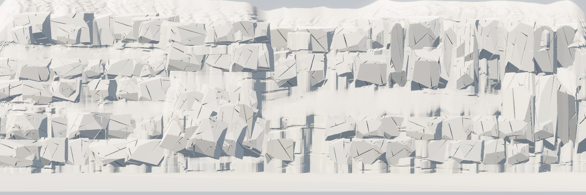

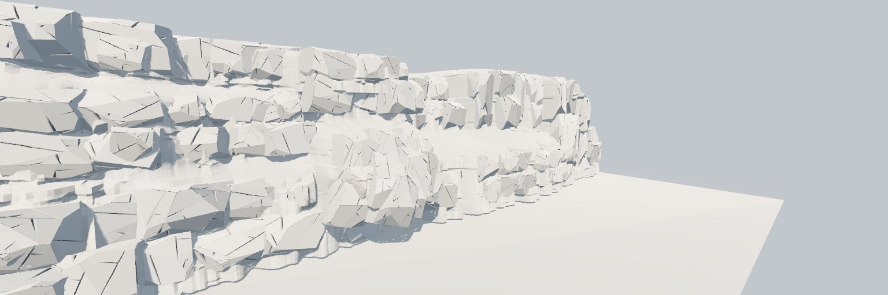

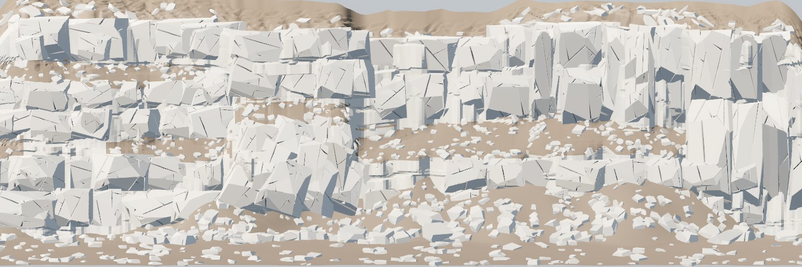

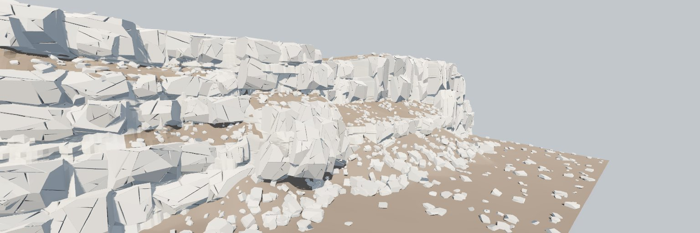

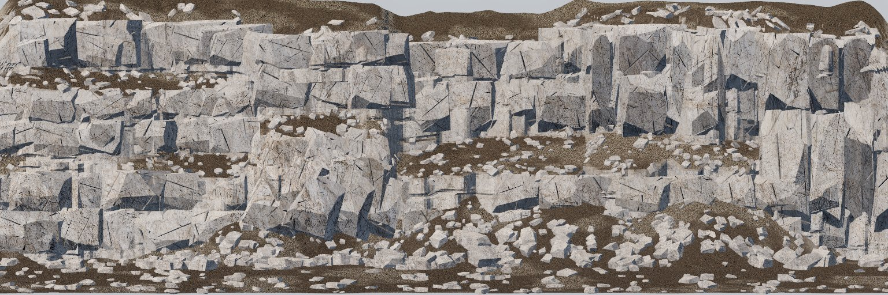

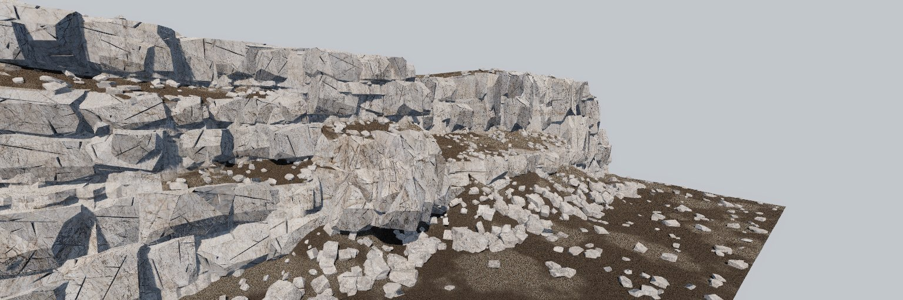

---

## 2. Study 1 — Incipient Surface Cracks (True 3D Recessed Crack Geometry & Self-Shadowing)

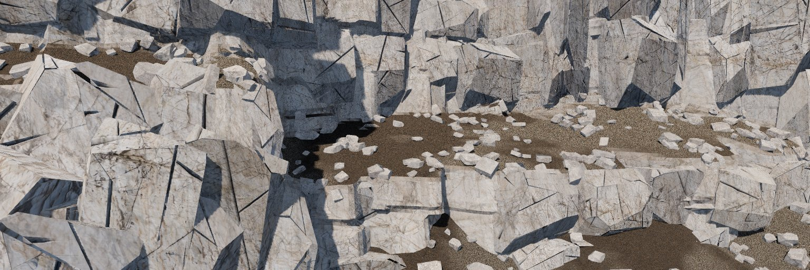

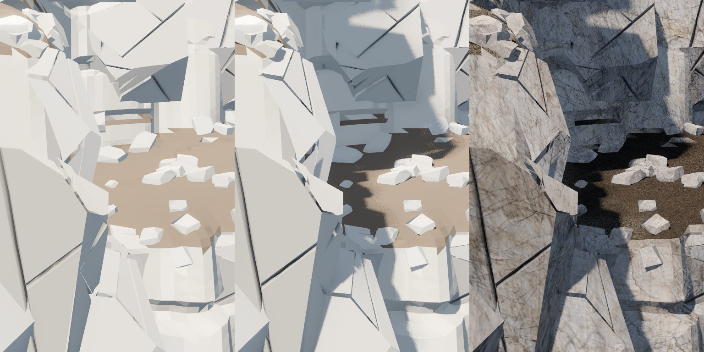

### How True 3D Recessed Cracks Work Inside a Single Block (`_emit_facet_with_recessed_cracks`)
- **Concave 3D V-Groove Carved *Into* the Facet (Zero External Faces)**:
  - Each large facet (`n.z > 0.25`) is split along a geological fracture plane `(c_nrm, c_off)` into two strictly convex sub-facets (`sub_poly_pos` and `sub_poly_neg`) whose lip endpoints slide strictly along the polygon's perimeter edges so nothing ever pokes past a bevelled corner.
  - Between the two sub-facets, a 6-segment jagged rock-cleavage groove is recessed `30–55 cm` *into* the stone (`-n * d_root`) across 4 distinct 3D strips:
    1. **Positive `48°` Chamfer Lip (`L_pos -> T_pos`)**,
    2. **Positive `83°` Steep Inner Cleft Wall (`T_pos -> R_mid`)**,
    3. **Negative `83°` Opposing Inner Cleft Wall (`R_mid -> T_neg`)**,
    4. **Negative `48°` Chamfer Lip (`T_neg -> L_neg`)**.
  - Supports **arrested crack tips** (where the 3D V-groove pinches down to zero width and zero depth `72%` of the way across the facet, leaving the rest of the stone undivided), **conjugate T-junction branch cracks** (`depth_lvl = 1` branching off the primary crack), and a **hinged pre-detachment step (`10–20 cm` along `+n` + `2°` micro-tilt)** on one side of the crack.

### Do We Need Self-Shadow for 3D Cracks to Read? *(See 3-Panel Comparison Above)*
- **Panel A (Left — Clay with `sun.shadow_enabled = false`)**:
  - **Normal Self-Shading (`N · L`) + Vertex Cavity Occlusion Do the Heavy Lifting at All Distances**: Because the two inner walls of the 3D V-groove face `83°` sideways in opposite directions (`±c_nrm`), whichever wall faces away from the sun has **`N · L <= 0` automatically** (receiving zero direct sunlight *without* needing the shadow map texels to resolve a `10–20 cm` slot!), while the opposite `48°` chamfer lip faces directly into the sun (`N · L ~ 0.9`) and catches a crisp bright rim highlight. Combined with vertex cavity occlusion (`Color(0.05, 0.05, 0.06)` at the groove root `R_mid`), the cracks read sharply even with directional shadows completely turned off.
- **Panel B & C (Middle & Right — Clay & Weathered Limestone with `sun.shadow_enabled = true`)**:
  - **Directional Self-Shadowing Adds the Pre-Detachment Step Shadow**: Turning on directional self-shadowing (`shadow_bias = 0.015`) adds a crisp projected shadow where the hinged pre-detachment slab steps forward (`10–20 cm`) over the adjacent half of the facet, as well as deep cast shadows across the master clefts and basal overhangs.

---

## 3. Study 2 — Cliff-Top Land, Ragged Rim Pavement, and Lateral End Transitions

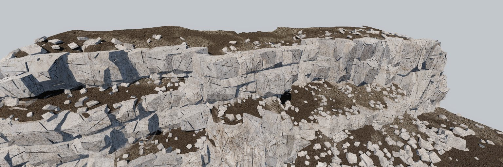

### What the Land Over the Cliff Looks Like & How It Meets the Ragged Edge
1. **Zone 1 — Ragged Rim & Karst Limestone Pavement (`0 to 12 m` back from the edge)**:
   - Above a limestone escarpment, soil is stripped back from the lip by wind and rainwater runoff draining into vertical joints.
   - This exposes the top of the upper caprock bed as a **karst limestone pavement**: flat-topped, weathered stone tables (**clints**, `1.6–4.2 m` wide × `0.32–0.72 m` thick) separated by deep, soil-and-moss-filled solution fissures (**grikes**).
   - Several rim clints sit slightly tilted or detached right at the ragged brow — visually explaining where the next generation of rockfall blocks will come from.
2. **Zone 2 — Heath & Stunted Rock-Pine Back-Slope (`12 to 45 m` back)**:
   - Further back from the edge, soil accumulates over the bedrock, grading into rolling moorland/heath (`scree` / `rocky_trail_02` earth blend) colonized by wind-pruned, shorter Scots pines (`6.5–11 m` tall vs. `16–21 m` in the sheltered valley floor).

### How the Ends of the Cliff Transition Back to Normal Land
> **Warning:** Judged poor in review: scaling the height down makes the beds droop, and the plateau never meets the valley floor. What nature does instead (level beds buried from the bottom up by a rising hillside) is in section 9 of [cliff_lab_findings.md](cliff_lab_findings.md). Not rebuilt yet.

---

## 4. Study 3 — Varied Lift Heights (`3.8 m` / `9.5 m` / `18.5 m` / `35.0 m`)

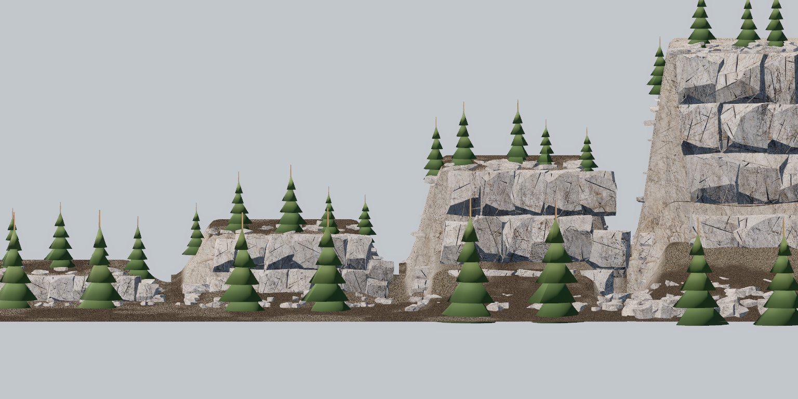

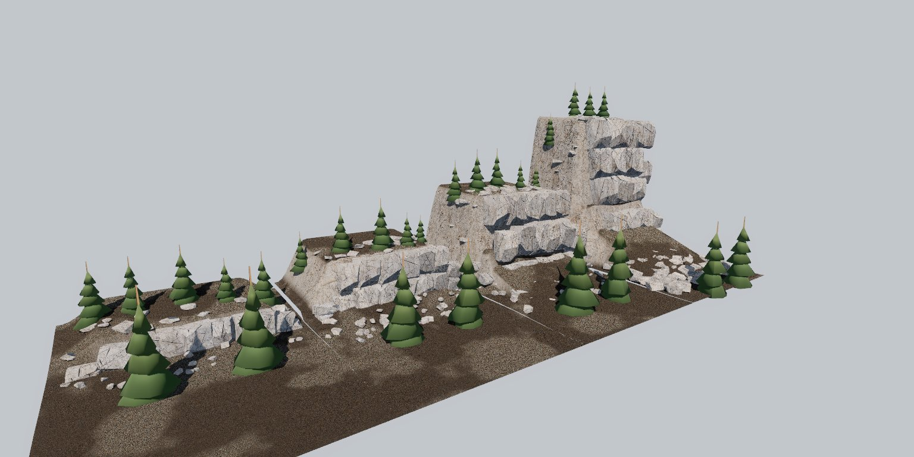

Each lift height has its own structural proportions, tier count, and mass-wasting footprint (shown side-by-side with `15–17.5 m` arena pines in front and `7–10 m` rock-pines on top):

| Lift Scale | Height | Natural Structure & Surface Alteration | Talus Apron (`H × W`) | Gameplay Role in Flap |
| :--- | :--- | :--- | :--- | :--- |
| **1. Micro-Outcrop** | **`3.8 m`** | Single massive caprock bed (`1 tier`), no bench; joints weather into rounded/tabular karst blocks emerging from soil. | `1.1 m × 3.4 m` (scattered toe boulders) | **Inside-Arena Feature**: Sits below pine crowns (`0.25×` tree height); ideal for clearing edges, low cover for rocket passes, and ground-level visual landmarks. |
| **2. Low Bluff** | **`9.5 m`** | Two stacked beds (`1 tier` with one horizontal parting undercut); blocky vertical face with incipient cracks. | `2.8 m × 7.5 m` (distinct boulder apron) | **Mid-Canopy Shelf**: Reaches mid-trunk height (`0.6×` tree height); creates sheltered wind-shadow lanes, low perches, and outlaw/outpost foundations inside the wood. |
| **3. Mid Escarpment** | **`18.5 m`** | Splits into **2 distinct tiers** separated by a stony-earth bench at `y ~ 7.5 m`; upper rim aligns with the `16–20 m` pine canopy tops. | `5.2 m × 13.5 m` (coalescing scree cones) | **Canopy-Height Wall**: Matches the treetops (`1.0×` tree height); birds skimming the canopy can hop directly onto the karst rim pavement or duck below the rim to break seeker LOS. |
| **4. Full Escarpment** | **`35.0 m`** | **3 tiers** with a wide mid-cliff earth & boulder bench (`y ~ 14 m`), tall fluted upper pillars, leaning monolith buttresses, and deep vertical clefts. | `9.2 m × 22.0 m` (deep coalescing apron) | **Arena Boundary / Ridge-Lift Wall**: Towers `2×` above the pinewood; generates strong upward ridge lift, high hawk/falcon stoops, and dramatic skyline framing. |

---

## 5. Study 4 — Macro Landform Topologies Around the Forest Arena

Each formation below is built at **full geological erosion detail** (`_build_eroded_cliff_along_spine()` in [`probe_cliff_lab.gd`](../../tests/probe_cliff_lab.gd)) on a `330 m × 330 m` terrain grid around the central pinewood (`16–21 m` pines, central clearing preserved, `11,000 lux` directional sun from the South-West). Every curved or multi-wall spine drives the full geological engine: embayed headlands & master clefts (`_z_rock`, `_skyline_y`), multi-tier stony-earth benches (`_bench_layout`), cliff-top karst grike pavement, gullied `27.5°` angle-of-repose talus cones, zone-specific 3D sculpted crags with recessed cracks, 2,600+ gravity-sorted boulders, and ecologically rooted bench/cleft/valley pines and shrubs:

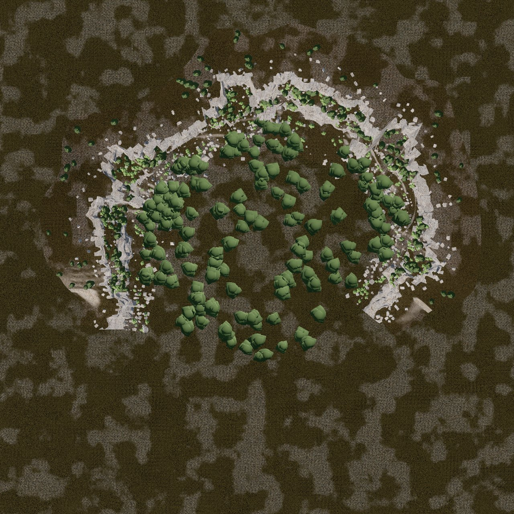

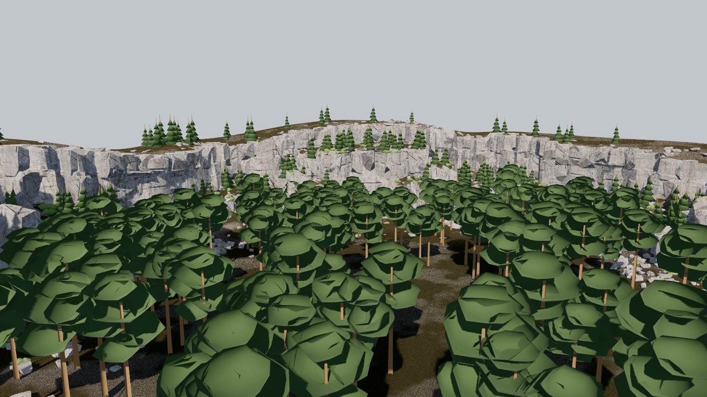

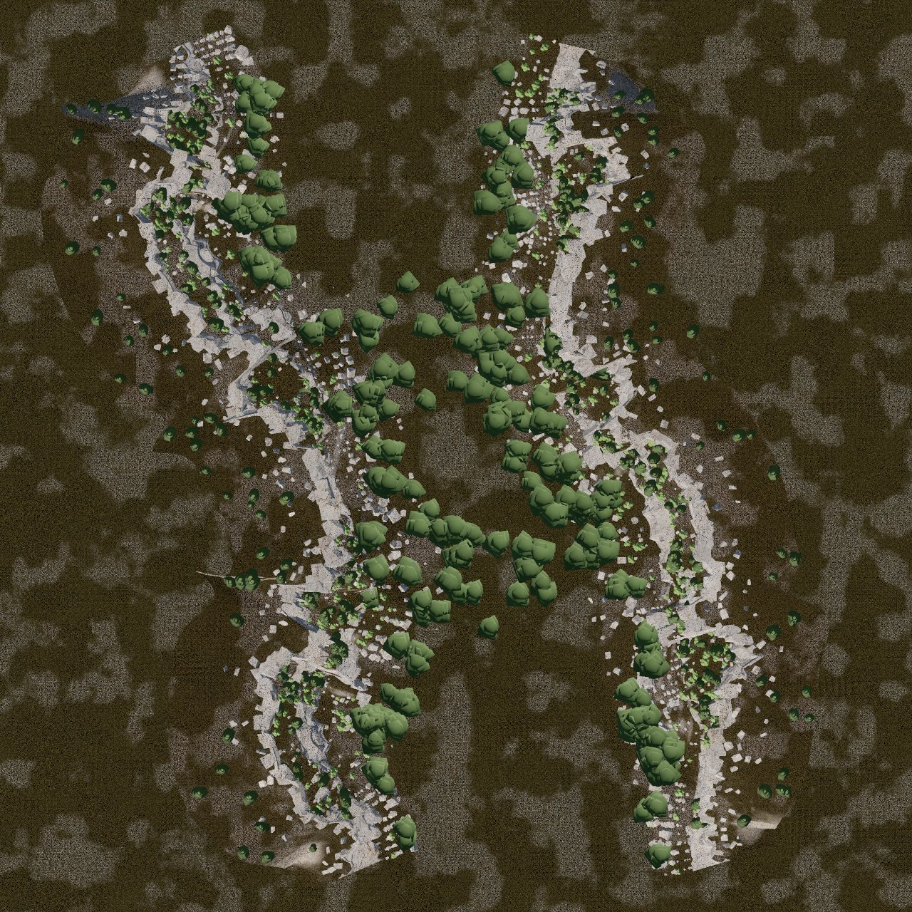

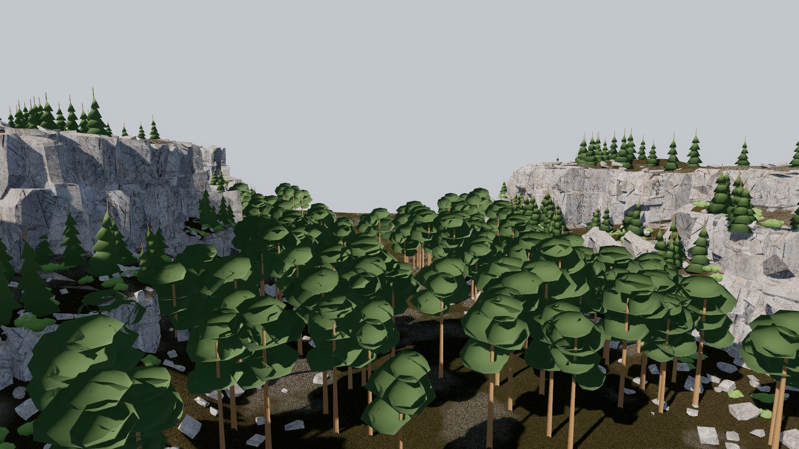

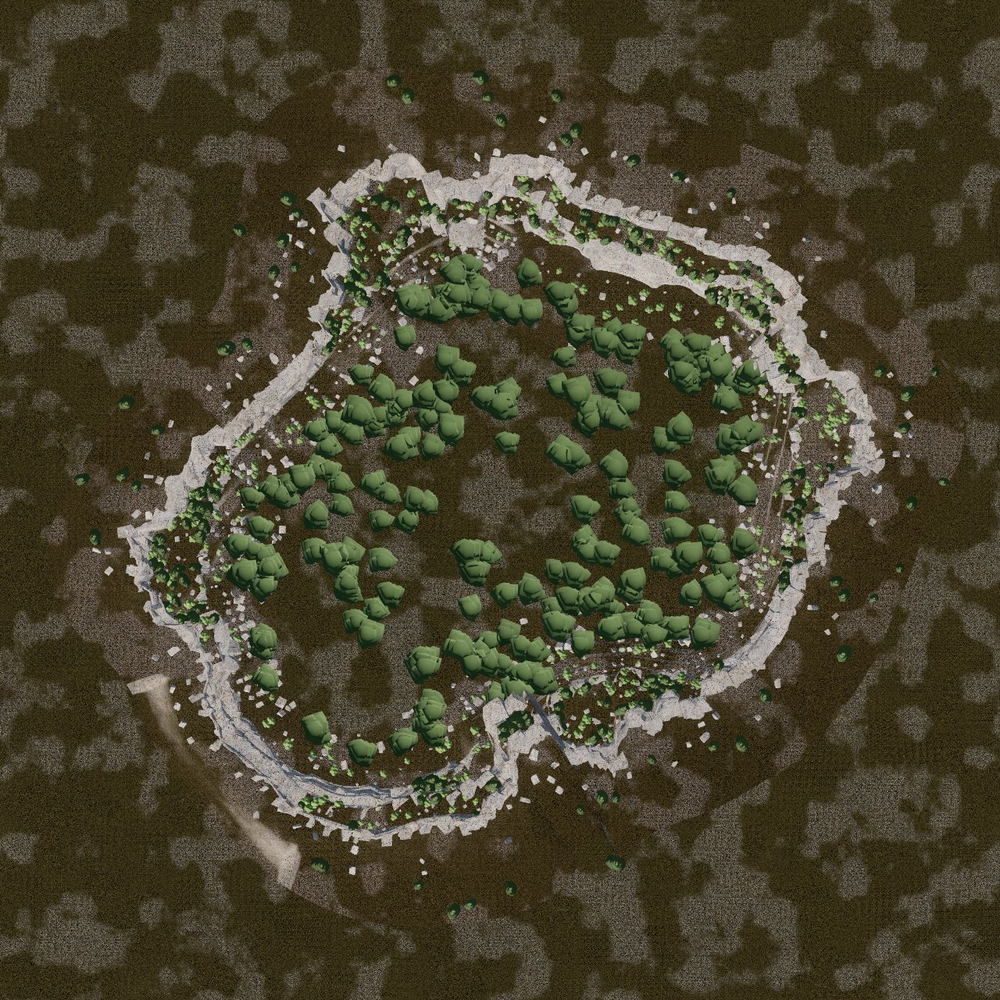

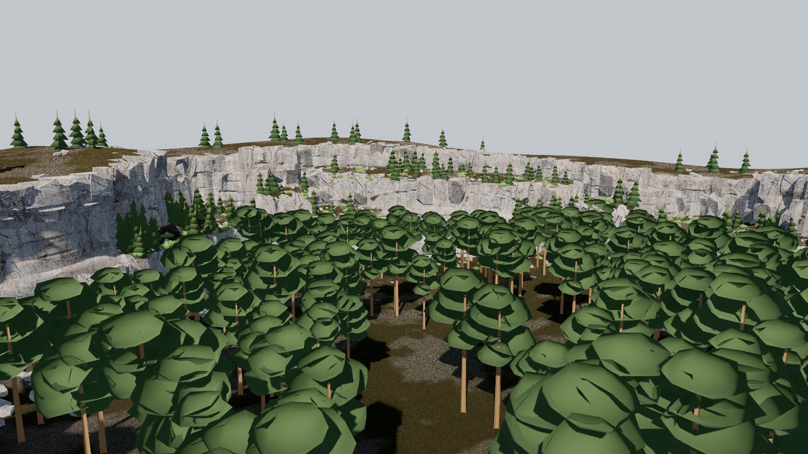

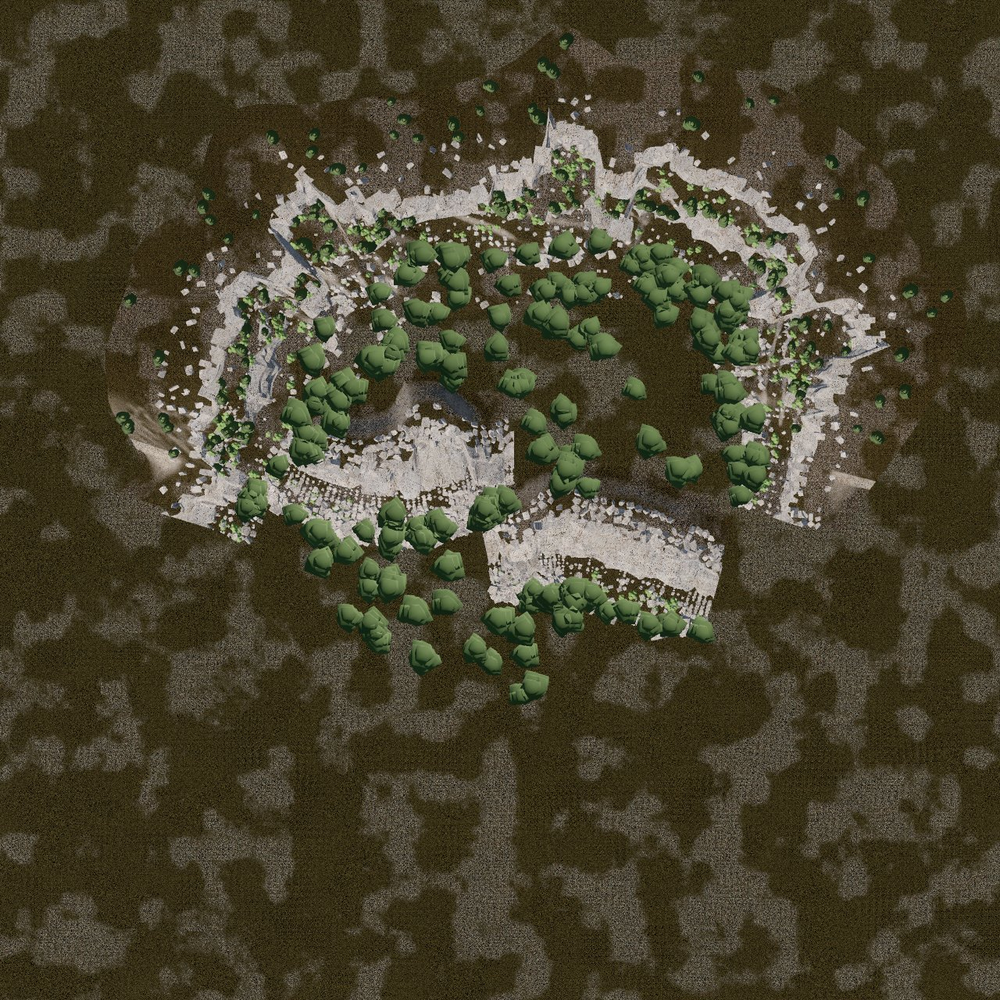

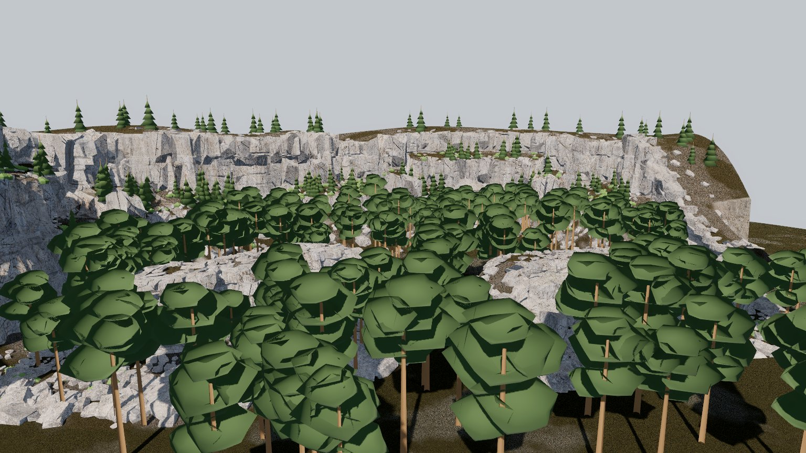

### How Each Formation Affects Playfield, Lighting, and Bird Flight

1. **Formation A — Crescent Amphitheatre / Cirque (`study4_*_amphitheatre`)**:
   - **Geometry**: A `210°` curved `35 m` escarpment wrapping the North and East of the wood, with both lateral horns tapering smoothly down into open heathland on the South and West.
   - **Lighting & Feel**: The concave bowl catches warm direct sunlight across its central and eastern facets while the western horn curves into self-shadow, giving instant compass orientation from anywhere in the trees.
   - **Flight & Tactics**: Concave curvature focuses ridge lift toward the central clearing; birds have an unmistakable theatre backdrop on three quarters and an open horizon on the fourth.

2. **Formation B — Box Gorge / Narrowing Valley Pass (`study4_*_gorge`)**:
   - **Geometry**: Two opposing escarpments (`34 m` NE wall and `26 m` SW wall) pinching slightly at the waist (`112 m` wide at the narrows) to form a forested canyon pass open at both ends.
   - **Lighting & Feel**: High-contrast duality — one wall blazes in full sun while the opposite wall sits in cool ambient shadow and casts long rock-tooth shadows into the western trees.
   - **Flight & Tactics**: Channels 3v3 matches along a natural axis between team bases, with wall-to-wall banking turns and cross-canyon sniper perches.

3. **Formation C — Karst Sinkhole / Collapsed Dolina (`study4_*_sinkhole`)**:
   - **Geometry**: A `360°` collapsed limestone bowl (`35 m` rim) enclosing the sunken forest, breached on the South-West by a collapsed `8 m` boulder saddle ramp.
   - **Lighting & Feel**: Creates an enclosed "lost world" sanctuary; as a bird circles the arena, the rock wall transitions continuously through full sun, grazing raking light (where every vertical fluting and facet crack pops), and deep backlight.
   - **Flight & Tactics**: Hard physical containment all around the arena (no soft boundary needed), with the SW breach acting as a natural low-altitude escape/entry chute.

4. **Formation D — Stepped Escarpment + Internal Outcrop Spurs (`study4_*_stepped_spurs`)**:
   - **Geometry**: Combines a `180°` `34 m` rear escarpment with **two `7.5–9.5 m` broken limestone outcrop spurs** jutting out of the forest floor right inside the central clearing.
   - **Lighting & Feel**: Brings the bright limestone facets and stony earth directly into the dark green pine canopy, breaking up the flat forest floor into multi-level rooms.
   - **Flight & Tactics**: Gives birds flying *below* the canopy hard rock cover to break seeker missile locks (`Launcher.sees`), low rock perches in the middle of the action, and varied lift heights within a single arena.

---

## 6. Study 5 — The Surrounding Karst Landscape & Protruding Ground Rocks

In a limestone escarpment landscape, the cliff does not rise out of a flat carpet of dirt — the surrounding forest floor and heath sit on the **same dipping sedimentary strata** and carry the long-term footprint of rockfall and karst drainage. Rock naturally protrudes from the ground in **four distinct ways**:

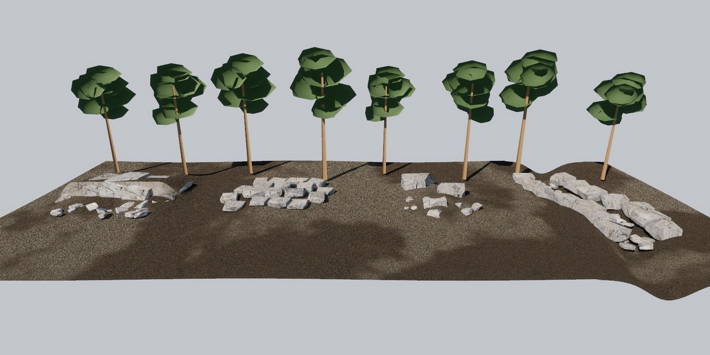

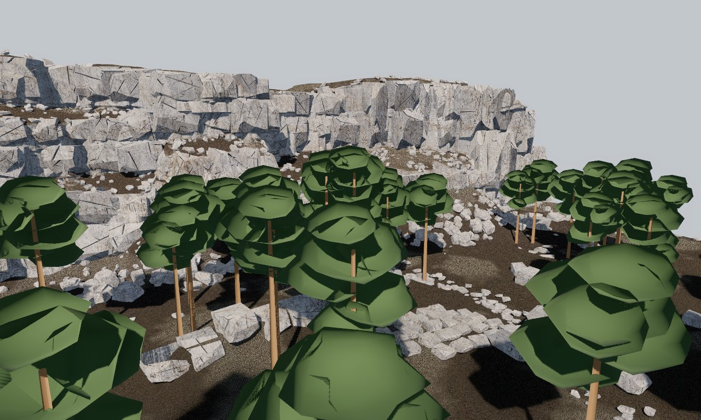

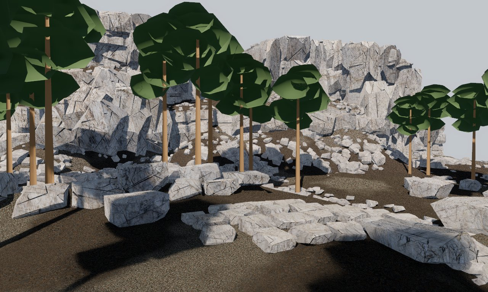

### The Four Natural Ground-Protruding Rock Types (Left to Right in Catalog)

| Formation Type | Geological Mechanism | Visual & Structural Signature | Gameplay & Visual Role in the Forest |
| :--- | :--- | :--- | :--- |
| **1. Emergent Dip-Slope Rib ("Whaleback" / Cuesta Ledge)** | A harder limestone bed (`1.5–2.8 m` thick) dipping at `12°–15°` breaches the rolling ground surface. | **Asymmetric**: soil and turf lap smoothly up the gentle back slope (`-Z`), while the down-slope edge (`+Z`) breaks off in a crisp, fractured `1.8–2.5 m` rock face with a small apron of spalled cobbles. | Strikes diagonally across the forest floor in parallel ribs that match the cliff's bedding dip, tying the ground plane structurally to the main wall and providing low, angled rock ramps and perches. |
| **2. Sub-Soil Karst Pavement Knoll (Flush Clints & Grikes)** | On slight ground swells (`+1 m` domes), rainwater and tree roots strip the thin forest soil down to the top of a horizontal bed. | Flat-topped, bevelled limestone tables (`0.25–0.75 m` proud of the dirt) separated by dark soil-and-moss fissures (**grikes**). | Creates natural sunlit stone clearings between tree clusters (`Pinewood` trees root in the soil margins around the knoll rather than through the solid slab) without obstructing low flight. |
| **3. Earth-Fast Founder Boulders (Half-Buried Erratics)** | Massive blocks (`2.0–4.2 m` across) from ancient rockfalls or periglacial freeze-thaw that rolled far (`30–90 m`) out into the valley floor centuries ago. | Unlike fresh white talus at the cliff toe, these sit **40–55% sunken into a raised soil collar** ramped up around their sides, with darker weathered flanks and stony-earth/moss caps on their upper facets. | Dots the outer forest and heath with landmark boulders that feel anchored *in* the earth rather than dropped on top of it; natural low perches and ground-skimming slalom obstacles. |
| **4. Dry Karst Wash Gully (Stepped Banks + Cobble Bed)** | Seasonal snowmelt and storm runoff pouring out of the cliff's vertical clefts carve a shallow winding trough (`1.5–2.0 m` deep) into the forest floor. | Eroded cut-banks expose **low horizontal bedrock ledges** on either side of a winding stream-bed carpeted in water-sorted limestone cobbles and gravel. | Visually connects the vertical clefts and talus cones of the cliff face out into the forest floor, guiding the player's eye and providing a sunken low-level trench through the trees. |

---

## 7. Study 6 — Ecological Plant & Tree Distribution by Rooting Depth & Disturbance

On a real limestone escarpment, vegetation never grows at random: **every plant guild is governed by rooting soil depth (`soil_m`) and rockfall disturbance (`chute`)**. Every tree, shrub, and crevice fern in [`_build_ecological_vegetation_study()`](../../tests/probe_cliff_lab.gd) is placed directly on the **exact mesh vertices** of the base talus, mid-cliff benches, karst rim pavement, plateau, and rock face (`lab.samples`, `lab.plat_verts`, and `_z_rock(fx, fy)`), with extended basal root skirts (`-0.44 m` on shrubs, `-0.18 m` on ferns) embedded `-0.12..-0.35 m` along the local surface normal so zero ground cover floats across recessed bays or steep slopes.

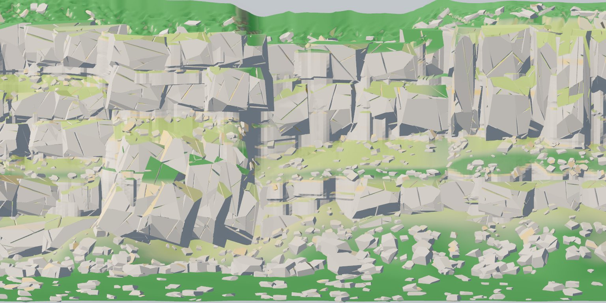

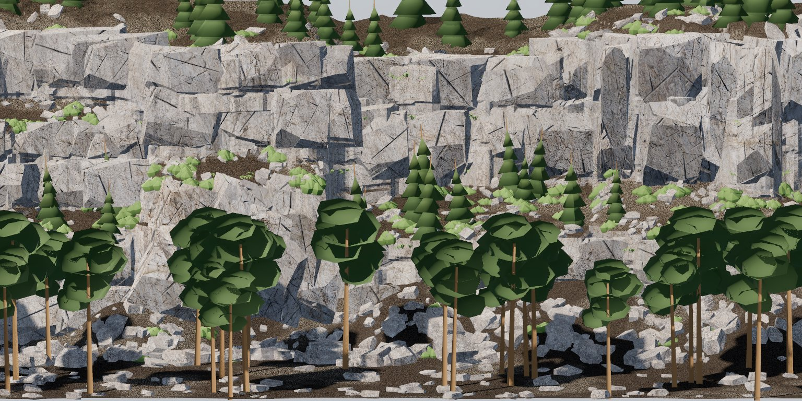

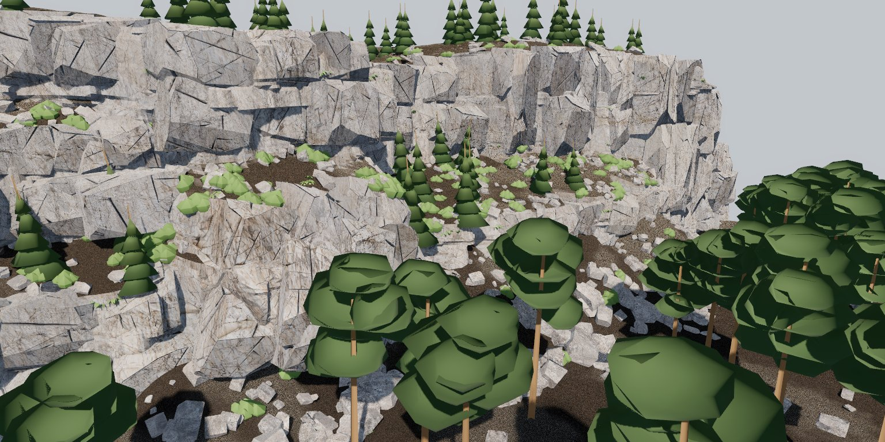

### The Four Rooting-Depth Habitats & Plant Guilds

| Habitat Zone (Diagnostic Color) | Rooting Soil Depth & Disturbance | Plant Guild Supported | Where It Occurs on the Cliff & Talus |
| :--- | :--- | :--- | :--- |
| **Zone 0 — Bare Rock & Active Chutes** *(Bone Grey)* | **`< 2 cm` soil** or high rockfall impact (`chute > 0.65`) | **Crustose Lichen & Algae Streaks Only** (no vascular plants) | Steep/overhanging limestone facets (`n.y < 0.45`), bare karst rim clint tops, and the **active boulder apex/chute of each talus cone** (where falling rocks smash saplings and open voids hold no fine earth). |
| **Zone 1 — Seepage Seams & Crevices** *(Ochre Gold)* | **`5–25 cm` humus** in narrow horizontal/vertical cracks | **Guild 1 — Chasmophyte Crevice Ferns & Grass Tufts** (`0.4–0.9 m` arching rosettes) | Traces the **horizontal softer marl parting seams** (`y = 6.2, 11.8, 19.8, 25.4, 30.2 m`) where groundwater seeps laterally along bedding planes, creating broken green horizontal contour lines across the wall. |
| **Zone 2 — Shallow Ledges & Talus Fringe** *(Olive Sage)* | **`25–75 cm` gravelly soil** (too shallow for tree taproots) | **Guild 2 — Woody Ledge Shrubs & Prostrate Juniper** (`1.1–2.4 m` multi-lobe low bushes) | Colonizes **narrow rock ledges (`1.0–2.5 m` wide)**, **grike fissures right at the ragged rim brow**, and the **stabilized outer flanks of talus cones**. |
| **Zone 3 — Deep Rooting Pockets** *(Deep Forest Green)* | **`> 0.8–2.0 m` colluvial / forest soil** & sheltered from rockfall | **Guild 3 — Stunted Bench/Cleft Pines (`6–11 m`)** & **Guild 4 — Tall Valley Scots Pines (`15–21 m`)** | **1.** **Wide Mid-Cliff Structural Bench (`y ~ 15 m`)** & **Deep Vertical Master Clefts (`x ~ -7.5, +21 m`)**: Stunted, outward-leaning `6–11 m` rock-pines anchor where washed-down soil and moisture collect. **2.** **Set-Back Plateau (`z < -4.5 m`)**: Rock-pines root behind the bare karst rim pavement. **3.** **Inter-Cone Valley Bays (`z > 13 m` between cones)**: Full `15–21 m` Scots pines advance up into the sheltered soil wedges *between* talus cones while parting around the bare boulder aprons. |
