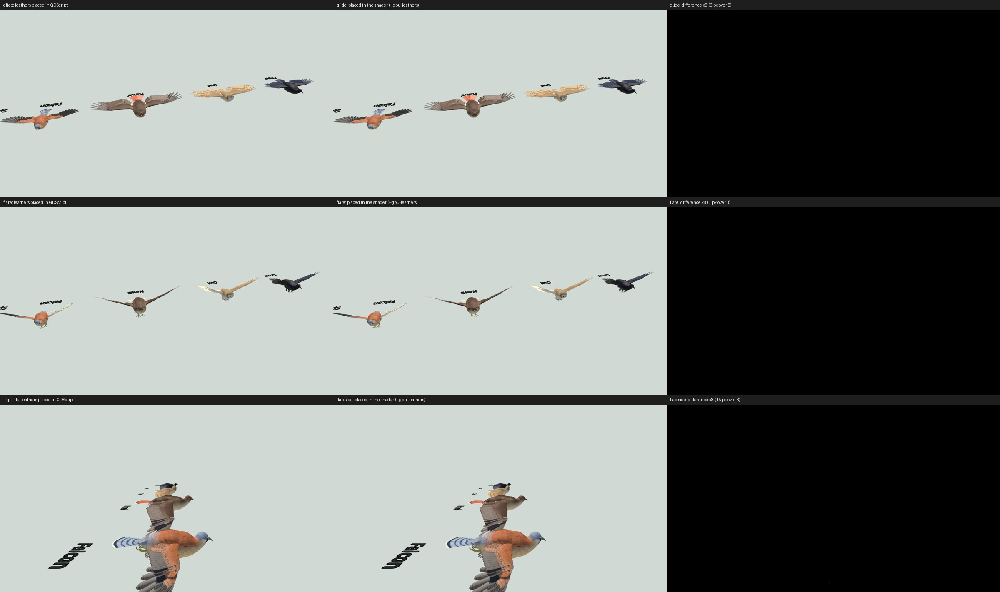
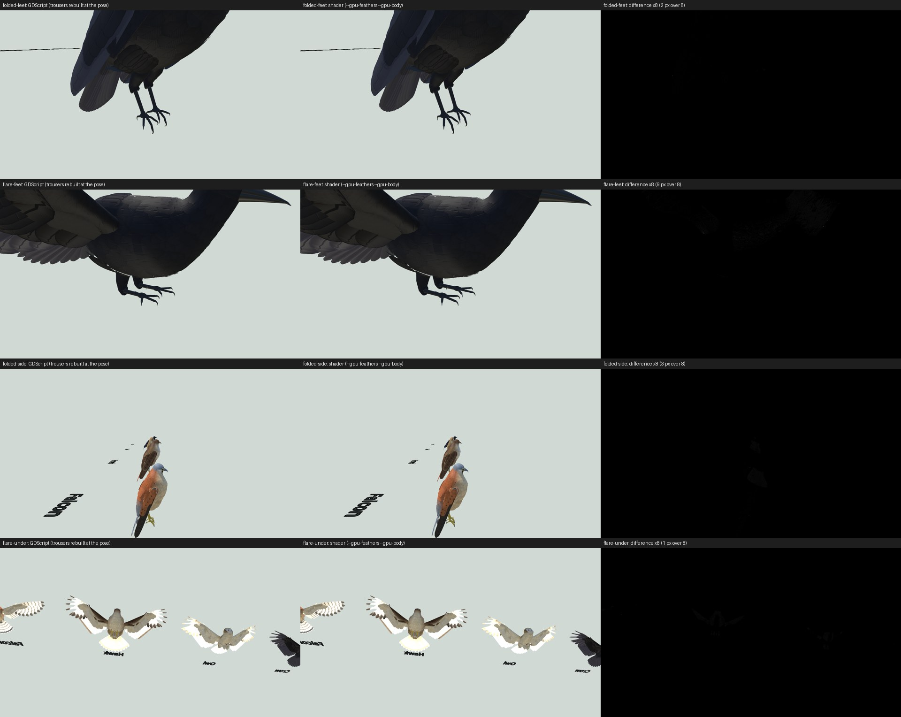

# Performance

Where a frame's time goes, what was done about it, and the rules that keep it there (2026-11-02). Measure with the
frame profiler: `.\perf.ps1 [-Bird hawk] [-Ai 3] [-Seconds 15] [-Extra --max-steps,3]` runs the game windowed and
writes a per-frame CSV and a summary (each `Perf` section per frame and per physics tick, frame pacing, ticks per
frame, the worst frames, the machine's CPU load while it ran). Code marks sections with `Perf.t()` / `Perf.add()`.

## What costs

Almost all of it is GDScript posing the birds' rigs. Rendering (about 1-3 ms GPU for 4 birds, 6-9 ms for 20) and
the physics engine itself (moving the birds: under 1 ms a tick for 20) are small; Jolt measured the same as the
default engine.

| 20 birds, per rendered frame | Mean | p95 |
|---|---|---|
| Start (legs rebuilt every tick, rig posed every tick) | 684 ms | 834 ms |
| Legs GPU-skinned | 427 ms | 562 ms |
| Arm and neck lofts moved in place, feathers' instance data written once | 290 ms | 380 ms |
| Rig posed once per rendered frame | 57 ms | 100 ms |
| ... and at most 3 catch-up ticks a frame | 50 ms | 92 ms |

Four birds: 94 ms -> 16.7 ms mean (60 fps), p95 206 -> 30 ms.

Posing the rig every frame for the drawn moment instead of on the tick (below) costs the same: 8.5 vs 8.3 ms of rig a
frame for 4 birds, 37.8 vs 37.3 ms for 20 (`-Extra --rig-tick` for the comparison). What it changes is what moves
when: at 4 birds about 1 frame in 85 runs no tick or two, and at 20 birds 4 frames in 5 run two or three; posed on the
tick, the lofts and legs stepped with those while the body and feathers moved smoothly.

## Rules

- **Pose the rig once per rendered frame, for the moment the frame draws** (`Bird._process`). With physics
  interpolation on, a frame draws each body between its last two ticks, `Bird.drawn_lag()` behind the latest. The rig
  is posed for that moment (for the simulated time since its last pose) with physics interpolation off on the rig, so
  the engine doesn't interpolate it again: feathers, lofted wing and neck, skinned legs and the tack all move every
  frame with the body. A frame catching up runs several ticks but draws once, and the rig with it (posing on every
  tick multiplied its cost by the catch-up ticks, so one slow frame made the next slower). Posed on the tick instead
  (the game's `--rig-tick`, kept for comparison), the feathers were interpolated but the lofts and the legs' bones
  aren't, so they stepped with the ticks: on a frame with no tick, or two, the wing surface held still or jumped
  against its own feathers. `test_rig_pacing`.
- **Simulation on the tick, drawing for the drawn moment** (Godot's physics interpolation docs). The birds, the AI,
  the flight model, rounds in flight and trail sampling run in `_physics_process`. What `_process` places by hand is
  placed for `drawn_lag()` behind the tick, with interpolation off on those nodes: rounds between their last two
  positions, smoke and wing trails running to where the round or wingtip is drawn. The chase camera follows
  `get_global_transform_interpolated()` with its own interpolation off, the docs' camera pattern. The tack is posed
  by the rig (`BirdRig.posed`), never apart from it. `test_drawn_moment`.
- **At most 3 catch-up ticks a frame** (`project.godot` `physics/common/max_physics_steps_per_frame=3`; the game's
  `--max-steps` overrides it). Overloaded, the game runs a little slow for a moment instead of skipping ahead in
  ever longer frames.
- **Don't rebuild meshes in GDScript every pose.**
  - The legs are skinned on the GPU (`docs/design/legs_and_feet.md` §7); their trousers are re-rested only when the
    leg's exit from the body drifts `TROUSER_DRIFT`.
  - The arm wing and the neck are `LoftMesh`es: built in full (colours, coordinates, SurfaceTool-smoothed normals)
    only when what those carry would change, otherwise only positions and normals are written into the vertex
    buffer. `test_loft_mesh` holds the fast path to the full build.
  - The feathers write only their transforms each pose; their instance data (strip row, share of the flex, atlas
    cell, seed) is written when the feather set or paint changes, and the wing's flex reaches the shader as one
    uniform.
- **Never read a mesh back from the GPU in a frame** (`RenderingServer.mesh_get_surface` stalls: a 30 ms frame).
  Keep CPU copies of what was written (`LoftMesh.positions`); tests read those (`BirdRig.drawn_arrays`,
  `LegRig.drawn_arrays`), since the headless renderer can't read updated meshes back either.
- **Fidelity first.** Performance work keeps the look; any level of detail, update throttling or simplification is
  proposed with its visual cost and agreed before it goes in. Approved for distant AI birds: keep the silhouette and
  the key colours; tolerances (the legs' drift) may grow with distance.

## What's left

A rendered frame at 60 fps allows about 0.5 ms of rig a bird for 20 birds; it is about 1.9 ms. Per bird per pose:
feather placement and writes ~0.8 ms, the arm loft ~0.7 ms, the neck ~0.5 ms, legs ~0.1 ms plus a trousers rebuild
(~3 ms) every few ticks while they swing. The 4-bird hitches (p95 30 ms) are mostly trousers rebuilds coming
together: 10-18 ms frames when several birds' legs swing at once (landings, take-offs). Next: the distant-bird level of
detail above, and spreading or cheapening those rebuilds; then, if needed, the feather placement in compiled code or a
vertex shader.

## Feathers placed on the GPU (on by default since 2026-11-03)

Since 2026-11-03 the GPU paths below are the default wherever there is a RenderingDevice; `--cpu-feathers` and
`--cpu-body` (game and rig gallery) put the work back in GDScript for comparison, and headless runs always use it.
The numbers below were measured as A/B against that.

`BirdRig.gpu_feathers` moves the flight and tail feathers' placement from GDScript into
the feather shader (`feather_place.gdshaderinc`). Each pose writes about 150 numbers (each wing's joints and normals,
the fold, the tail's frame) into a small float texture. Each feather's own definition goes into another texture
once: the only part of it that changes with the fold and slot, its angle, is linear in both, so it is stored as
three terms and worked out in the shader. The instances' transforms stay identity, so their bounds are set by hand
(`custom_aabb`). The silhouette cards share the material and keep their own transforms (`def_offset` -1).

Measured A/B (game on autopilot, quiet machine, 15 s runs):

| | Feathers placed in GDScript | Placed in the shader (and the lean probed there) |
|---|---|---|
| 4 birds: rig per frame | 11.9 ms | 8.4 ms |
| 4 birds: wings and feathers | 5.6 ms | 2.3 ms (the arm loft) |
| 20 birds: rig per frame | 58.6 ms | 43.1 ms |
| 20 birds: wings and feathers | 26.1 ms | 10.9 ms (the arm loft) |
| GPU time, 4 birds | 7.35 ms | 7.38 ms |

The pictures match: in the rig gallery (glide, flare, folded, flap from below and the side) at most 15 of 1.44
million pixels differ, along feather edges.

Tests read back what the GPU computed. `tests/gpu_test_feathers.gd` evaluates the same include in a canvas pass into
a half-float target (each value split hi + lo, about float precision) and compares every feather with the rig's own
placement: within 0.2 um, every species, spread to folded, alula, slots, lost feathers. GPU tests are named
`gpu_test_*` and run windowed (`test_runner.ps1` leaves out `--headless` for them), since the headless renderer runs
no shaders.

A sitting bird's lean reads every feather's tip (`_posture`: the deepest inside what it sits on). With the feathers
placed on the GPU it is measured there too (`LeanProbe`): each sitting bird gets a pixel of a small half-float
viewport, `lean_probe.gdshader` places its feathers with the same include and measures their tips against the
surface, and the row comes back through `RenderingDevice.texture_get_data_async` a frame or two later -- the frame
never waits on it. The lean eases in over a fraction of a second, so the late answer doesn't show; with no answer
yet for a perch the lean holds. `gpu_test_lean_probe` holds the probe to the rig's rule (every species, branches
across and along, a treetop, the ground; tips inside and clear: within 1e-5 m), `gpu_test_posture` runs
`test_posture` with it, and `gpu_test_feather_image` renders every species both ways and compares the pictures.

What stays on the CPU: a hit works out the flight feathers of that pose in GDScript (`flight_feathers`, once a hit).
Damage is simulation: it has to be the same every run and run headless, so it doesn't wait on the GPU. That copy of
the placement is also what the GPU tests compare against.

GPU time read with care. The GPU clocks down when the CPU leaves it idle: the same 4-bird scene reports 6.7 ms of
GPU at 60 fps and 37.6 ms capped at 8 fps (`-Engine --max-fps,8`), so the 33-38 ms seen at 20 birds (8 fps,
CPU-bound) says little about the work. At 60 fps it is 6.7 ms (shadows 2.4, the opaque pass 2.0, the depth pre-pass
1.7, the rest under 1), the same with 1 bird or 4: mostly the forest. `.\perf.ps1 -Engine --gpu-profile` adds the
GPU's time by render pass to the report.

## The neck and arm wings lofted on the GPU (`BirdRig.gpu_body`, 2026-11-02)

`BirdRig.gpu_body` lofts the neck and both arm wings in the body shader instead of in
GDScript (`neck_place.gdshaderinc`, `arm_place.gdshaderinc`, picked per mesh by the instance uniform `gpu_surface`).
Each is a fixed mesh of the loft's rows and columns (UV: row, column) that the shader moves; every vertex works out
its own position, its normal (LoftMesh's rule: its triangles' unit normals summed, over its 3 x 3 neighbours), colour
and feather coordinates. A pose writes a few numbers: the neck's centreline and head frame and how its rings pair
(the pairing itself still found in GDScript, as before), each arm's joints, normal and opening. What never changes for
a bird goes into tables once: the head's neck ring and the trunk's front ring with their colours and coordinates; the
trunk's rings, its feather grid and the species' plumage zones (`BodyShape.ring_at`, `half_width_at`, `uv_at` and
`Plumage.body` are ported to the shader, so the arm's loop on the trunk takes the trunk's colour and coordinates where
it lies, every frame -- the rig rebuilt them only when the loop had moved `ARM_REBUILD`).

| 4 birds, per frame | GDScript | Shader |
|---|---|---|
| neck | 1.39 ms | 0.34 ms (the ring pairing) |
| arm wings | 2.29 ms | 0.05 ms |
| rig in all (feathers on the GPU in both) | 8.0 ms | 4.6 ms |

At 20 birds the rig went from 44 to 24 ms a frame; what's left is mostly the legs' trousers (17 ms). The GPU spends
about 0.3 ms more at 4 birds (the depth pre-pass).

Tests: `gpu_test_neck` and `gpu_test_arm` read the shader's vertices back (the same includes, in a capture pass) and
hold them to the rig's lofts -- positions within 1e-7 m, normals within 1e-4, colours and coordinates within 1e-5 --
for every species, the head turned every way, the wing spread to nearly folded, flapped, twisted, swept. The
arm's wrist end is a straight segment of slivers inside the hand's piece, whose normals are rounding on either side:
held to the rig's positions there, and to unit normals. `gpu_test_feather_image` renders every species both ways.

Two GPU lessons: GPU compilers reorder arithmetic, so points the rig places at exactly one spot can land a rounding
step apart, and a triangle that is exactly nothing on the CPU gets a whole normal -- the arm treats a triangle with an
edge under 0.1 um as none. And a function this long, indexing a local array in a loop, came out wrong on this GPU:
the neighbours are named variables.

## The legs' feather tubes ("trousers") built on the GPU (`BirdRig.gpu_body`, 2026-11-02)

With `gpu_body` the trousers are built in the body shader every frame too (`trouser_place.gdshaderinc`, sharing the
body's lookups with the arm in `body_place.gdshaderinc`). Nothing is rebuilt, re-rested or skin-weighted any more,
and there is no drift threshold: they are exactly LegRig's construction every frame, where before they were skinned
between rebuilds (up to `TROUSER_DRIFT`, 2 mm, off) and each rebuild cost 2-4 ms.

The construction is kept as it was. It turned out cheap to keep its rules: each pose `LegRig._gpu_layout` lays out
each leg's rows -- where the leg leaves the body, each ring's centre, frame and radii, the skirt's, the owl's last
rows to the pad -- about 150 numbers a leg, a few microseconds. Rows that a pose doesn't have are the last row again
(zero-area triangles: MeshBuild's normals weigh triangles by area, so they add nothing). The shader does every
vertex: the loop dropped onto the trunk along the shell's normal (the same bracket and halving as `_shell_loop`),
the trunk's colour and normal there from its mesh's grid, the fillet, the rings, the pass down each column that
stops them crossing at the ankle, the skirt, the hem as the skin draws it (the skin's top ring in the tarsus bone's
frame), colours, feather coordinates and area-weighted normals. Built on the unscaled trunk, then the loop and
fillet scaled with the trunk as its bone scaled them.

| Rig per frame (feathers, neck and arms on the GPU in both) | Trousers rebuilt in GDScript | Built in the shader |
|---|---|---|
| 4 birds | 7.6 ms (legs 2.9, of it rebuilds 2.0) | 2.9 ms (legs 1.2) |
| 20 birds | 41.9 ms (legs 17.8) | 11.6 ms (legs 4.6) |

The 4-bird frame's p95 went from 25 to 20 ms (the rebuilds' spikes, 10-18 ms frames, are gone).

`gpu_test_trousers` reads the shader's vertices back and holds them to `_build_feathers`'s build of the same pose --
positions within 1e-7 m, normals 1e-4, colours exact, coordinates 2e-5 -- every species, both legs, perched,
flaring, reaching and tucked part way, the leg leaving on the tibia and on the tarsus, the owl's tube to the pad,
and its faces wound as MeshBuild winds them (the legs mirrored, the right leg's the other way round: wound the
same, the right tube showed its inside from below, which the readback alone didn't see).

