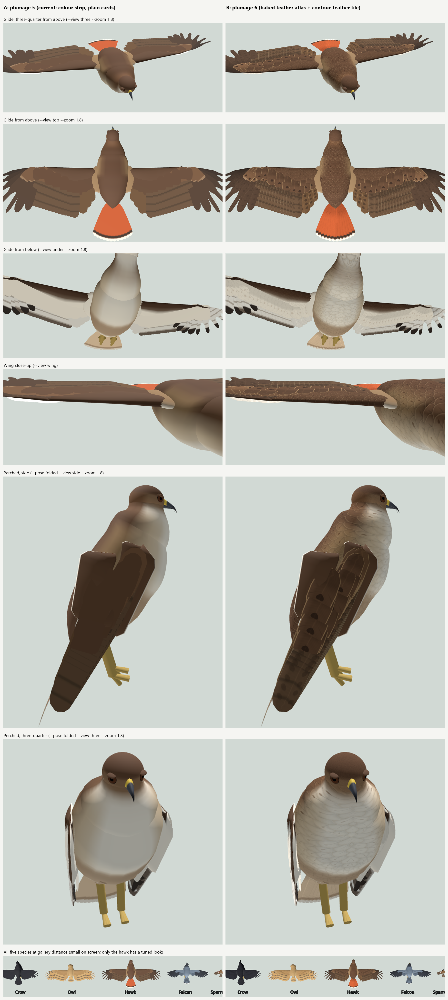
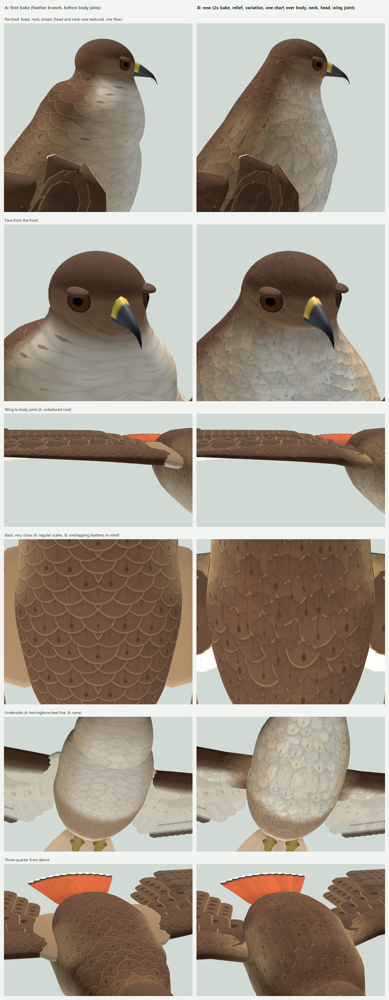

# Feather texture study

**Status (2026-11-02).** Adopted: level 6 is the default plumage. The first pass (below, from "What was built")
was the experiment. "Second pass" right after this note records what changed when it was taken: the body's
feather chart, a sharper bake with relief, variation against repeats, and a note on going further.

**Question.** The birds have shape and colour but no feather texture. Can baked feather textures get us toward
the two concept images (rows of overlapping feathers, each with a shaft, soft rounded tip, spots or bars toward
the tip, pale fringes, small scalloped feathers on the back) without the sheen problem of the parked
`feather.gdshader`, and cheaply enough for about five birds under a chase camera?

**Answer, in short.** Yes for the wings and the back: at close and middle range it is clearly better than
plain colour, and it costs almost nothing. It is not yet the photographic look of the references. The
underside is mixed, and the body pattern is a stand-in until the body mesh carries UVs. **Recommendation:
proceed**, on the conditions under "Recommendation" at the end.

**How to see it.** `--plumage 6` in the rig gallery (now the default everywhere):

    .\run.ps1 --scene res://scenes/rig_gallery.tscn --only hawk --pose glide --view top --zoom 1.8 --plumage 6

Only the hawk has a tuned look (`Plumage.TEXTURE`). The other species get the texture's structure (shafts,
barbs, layer shadows) with no spots or fringes.

`docs/images/feather_texture_ab.png`: A is level 5, the current look (the colour strip on plain cards); B is
level 6. Same pose, camera and frozen clock in each pair.

## Second pass: taken, sharper, less repetitive

`docs/images/feather_texture_v2_ab.png`: A is the first bake on its own branch (before the body joins); B is
now. The hawk, same poses and cameras.

### One feather chart over the body (the "What the body mesh must provide" list, done)

The trunk, neck, head and the wing's arm loft (and its limb pieces) now carry feather coordinates as UVs, and
share one material, so the contour feathers run on across every join. That includes the wing-to-body joint,
which the first pass left untextured. (`BirdRig`, "Feather coordinates"; `BodyShape.trunk_mesh`,
`BodyShape.uv_at`, `BodyShape.ring_arcs`; `body_feathers.gdshader`.)

- **UV** = (u across the flow, v along it), in tiles, with tips toward +v. **UV2** = (u's period, up).
  **COLOR.a** = the texture's strength there.
- **Trunk.** u is the arc round each ring from the spine, signed. v is the arc back along each lengthwise line.
  Both are divided by the local feather size: 0.75 of the tile at the breast's front, 1.0 mid-body, 1.12 on the
  rump.
- **One seam, no mirror.** u runs on round the ring and is periodic in the ring's girth. The shader wraps it,
  and within `seam_band` of the seam (under the belly and the chin) it cross-fades with the other side's read.
  So there is no seam and no mirror line: the first pass's herringbone down the keel is gone.
- **Head.** Polar coordinates round a pole just above the bill. The head is projected stereographically from
  the neck's pole, so the neck's ring becomes a circle, and a disk automorphism moves the pole toward the bill
  (`HEAD_POLE`).
  - Every point of the neck ring gets the same v, so the neck's rows start level.
  - u is measured by where the point's flow line meets the ring, round the ring itself. So it is spaced evenly
    there, like the neck's.
  - The feathers run back from the bill over the crown, the cheeks and the chin.
  - The texture fades near the pole, where rows crowd. The head is built with per-triangle unwrapping
    (`BodyShape.tube_mesh(..., per_triangle)`), because its u seam crosses the mesh's rings.
- **Neck.** Each vertex blends its coordinates from its trunk partner's to its head partner's, as its position
  does. So the feathers stretch and twist with the neck and never slide. It now pairs with the head's ring at
  the head's own resolution (60 points, not 20), so the neck's feathers don't jump a whole step as the head
  turns.
- **Arm loft.** It starts from the trunk's own coordinates at its edge loop on the shoulder. Then u runs
  outward along the arm and v aft across the chord, in the coverts' size (0.7). Its coordinates are fixed per
  station and section point, so the coverts ride on the surface as it flexes and folds.

Two things the debug view (`--chart` in the gallery: u lines red, v lines green, the seam's cross-fade blue)
showed:

- **The head's chart.** A conformal chart centred on the bill gave the neck's ring very different v front and
  back. That turned the breast's rows lengthwise, which read as streaks. The current chart fixes it.
- **The first bake wasn't isometric.** Its projection used z for v, and stretched the rows about 1.45 times
  apart. That stretch is what made its scallops so crisp and regular. The chart is now true to the surface, and
  `row_spacing` (1.45) keeps that look on purpose: it shows more of each feather.

`tests/test_feather_texture.gd` checks that the coordinates agree where the neck meets the trunk and the head,
and where the wing's surface meets the body. `tests/probe_feather_chart.gd` prints the neck's two ends.

### Sharper close up

- **Twice the resolution.** The atlas is 2048 x 1536: a flight-feather cell is 256 px across, 128 px per
  half-width. The body tile is 1024, 256 px per contour feather.
- **Finer barbs.** The barbs are finer (12 per half-width, and a finer barbule sheen) and quieter. The first try
  at full strength read as herringbone wallpaper.
- **Relief maps** (`*_n.png`), baked from a height field:
  - feathers: the vane's cup, the shaft's ridge, the barbs, a split's groove;
  - body: each feather rising toward its tip, domed, and stepping down onto the row behind.
  - They are applied in a cotangent frame from screen derivatives [SCHULER13], so they work on any of these
    meshes, on either face and either wing, with no tangents.
  - This is most of the "texture under light" gain: rows read as layers even where colour alone is flat.
- **Ragged outlines.** Vane edges are a little ragged where barbs part, with a notch where a split reaches the
  edge. Body feathers have uneven rims. The alpha scissor cuts the outline from the baked edge distance, so the
  silhouette is less card-like.
- **Cost.** 5 flapping birds, `--measure 900`, two runs each:
  - GPU: 1.80 ms at level 5 against 1.97 ms at level 6, about 0.035 ms per bird.
  - CPU pose: 17.7 ms against 18.9 ms, about 0.25 ms per bird, for the coordinates the neck and arm loft
    recompute each pose.
  - The pose baseline itself, about 3.5 ms per bird since the body joins, is the real cost to look at next.
  - VRAM: about 22 MB lossless with mipmaps (atlas, body tile and their relief). VRAM compression (BC7 for the
    masks, RGTC for the relief) would cut that about 4 times.
  - The baker takes 25 s and stamps its own MD5 next to the PNGs. The test compares the stamp instead of
    re-baking.

### Randomness against repeats: what is appropriate

Real plumage is regular in structure and irregular in detail. Bars line up across a wing, rows run in tracts,
and the feathers of a tract are one kind. But no two feathers are identical, and wear is uneven. So the rule
here is: randomise per feather and over large patches, and never break the things that line up on a real
bird.

**Done:**

- **Atlas variants with no repeated neighbours.** There are 4 covert variants (they are the most numerous and
  most visible units) and 2 per flight feather. The order along a row is random, but two neighbours never
  match (`FeatherAtlas.cell`), so a row of coverts doesn't read as a stamp.
- **Per-feather variation** (a seed per instance, `INSTANCE_CUSTOM.a`; a random value baked per body feather):
  - tone ±4 %;
  - warmth ±2 %;
  - spot size ±17 % and spot amount ±25 %;
  - fringe width ±30 %: fringes wear unevenly, and the tips abrade first.
- **Large-patch variation of the body tile.** The tile is read at an offset that wanders with a slow noise, a
  few tiles across. Where it changes it uses two reads, switching where one read's feather lies further inside
  its outline than the other's, so the switch follows feather edges rather than blurring across them
  [IQ-REP]. A slow ±4 % mottle sits over the tracts.

**Deliberately not randomised:**

- the bars' position along flight feathers, which stay in register across the wing as on a real bird;
- feather direction, or tile rotation, which would break the flow of the tracts;
- the tract layout itself.

**Next:**

- small per-feather length and angle jitter in `WingShape`, a degree or two;
- an occasional slightly worn or displaced feather;
- per-individual variation, so two hawks differ: shift the seed per bird;
- hex-tiling [HEX22] if the wandering offset's change-overs ever show.

`--variety 0` in the gallery turns all of it off for comparison; `--relief 0` the relief.

### Going further: higher realism

In order of value for the cost:

1. **Silhouette and parallax, with geometry.** The texture can't lift a feather's edge.
   - Add 20-40 contour-feather cards per bird where the outline shows: scapulars over the wing root, flank
     feathers over the folded wing, the "trousers", the rump over the tail.
   - Add a median covert row and smaller, more numerous lesser coverts in `WingShape`.
   - This is the main thing the reference art has that we don't.
2. **Lighting.**
   - Shadows and ambient occlusion between rows.
   - A soft sky and bounce light.
   - A little view-dependent sheen on flight feathers (anisotropic, along the barbs). The parked
     `feather.gdshader` sheen flooded, so it needs to be subtle and masked by the relief.
   - Translucency for backlit primaries.
   - The gallery has none of these. Much of the references' realism is light, not texture.
3. **Per-species looks.** Tune `TEXTURE` for the owl (soft, barred and mottled), the falcon (barred
   blue-grey), the sparrow (dark centres, buff fringes) and the crow (gloss on the shaft only).
4. **Shell or fin fur for down** at the silhouette (owl), and loose barbs at the edge, at a close-up level of
   detail only.
5. **Painted or photo-sourced masks.** A hand-painted or photo-derived atlas would beat procedural barbs at
   very close range. It would keep the same channels and cells, so nothing else changes.
6. **Skinned, sculpted art** (Blender) only if the procedural body reaches its limit. The chart, the masks and
   the shader would carry over as the art's UVs.

Feather cards on top of the textured body (1) and better light (2) would close most of the remaining gap to
the references. Textures alone are near their limit at this camera distance.

### Third pass: the silhouette, light and the flight feathers (2026-11-02)

**Silhouette cards.** The textured shell's outline is a clean curve. On a bird, the feather tips break it.
`BirdRig` adds small contour-feather cards, about 66 per bird, in four tracts (`CARD_TRACTS`):
- **scapulars** over the shoulders, lying onto the wing root and the top of the folded wing;
- **flanks** below the folded wing;
- **the rump**: the uppertail coverts, which follow the tail's pitch part way;
- **the vent**: the undertail coverts.

How they're built:
- Each card takes the body's colour where it is rooted, and the lesser-covert atlas cells, as row `contour` of
  the feather material. That row's spot colour is a multiple of the card's own colour, as on the body tile.
- The cards are children of the trunk, so fluff and breathing scale them.
- Flat and small: the first, larger and lifted cards stood off the curved back as a shelf.
- The legs' trousers are left to the leg rig.
- Switch: `BirdRig.silhouette_cards`; gallery `--no-cards`.
- Images: `docs/images/silhouette_cards_ab.png`.

**Light** (`scripts/app/lighting.gd`, `docs/images/lighting_ab.png`):
- sky ambient;
- bird-scale sun shadow cascades and small-radius SSAO, in the game too;
- per-group gloss and translucency (`Plumage.GLOSS`).

Translucency uses Godot's transmittance terms, not `BACKLIGHT`: the feather above shadows each card, and
`BACKLIGHT` is shadowed with it.

**Flight feathers** (`docs/research/flight_feather_look.md`, which ranks what reads at whole-bird distance;
`docs/images/flight_feather_ab.png`):
- **Vanes.** The outer and inner vanes are coloured apart (`TEXTURE` `vane`), and fringes are per vane
  (`fringe_vane`: the sparrow's outer-vane edges).
- **Bars.** Bars are read in metres from the tip, so they run on as bands across feathers of different lengths.
- **Overlap.** A soft step shadow falls where the inner neighbour covers the inner vane; it deepens as the wing
  folds (uniform `cover`).
- **Crow.** A blue-violet gloss tint.

Still to do, from that ranking:
- cupped and twisted vane geometry;
- the emargination and notch outline;
- anisotropic sheen;
- wear and moult gaps.

**Down at the outline** (`scripts/bird/body_down.gdshader`, `docs/images/outline_down_ab.png`). On a real bird,
loose barb tips and down soften the outline. The body meshes are drawn twice more, as next passes of the body
material: two shells 3 and 6 mm out on a 45 cm bird.
- **Strands.** Each shell shows scattered strands along the feather flow (the chart's v). Fewer and thinner
  ones survive further out.
- **Where.** Only where the surface is seen edge-on. Face-on, they would blur the texture.
- **Light.** The strands glow with the sun behind them.
- **Cost.** Cards and down together add about 0.05 ms of GPU per bird.
- **Switch.** `BirdRig.outline_down`; gallery `--no-down`.
- **Open.** The strands are hard-cut (alpha scissor), so the fringe is a little speckled. Alpha-to-coverage or
  a dithered fade would soften it.

## What was built

| Piece | File | What it does |
|---|---|---|
| Baker | `scripts/bird/feather_atlas.gd` (`FeatherAtlas`), run by `tools/bake_feathers.gd` | Generates the two textures procedurally (about 5 s in GDScript, offline) and saves them as PNGs, imported with mipmaps. |
| Feather atlas | `assets/feathers/feather_atlas.png` (1024 x 768) | Six feather types (primary, slotted primary, secondary, tail, greater covert, lesser covert), two variants each. |
| Body tile | `assets/feathers/body_scales.png` (512 x 512, repeating) | 4 x 8 small rounded contour feathers. Each is nudged and sized at random, overlapping like roof tiles with the head-end row on top. |
| Feather shader | `scripts/bird/feather_texture.gdshader` | The level-5 strip colour, read through the atlas. |
| Body shader | `scripts/bird/body_feathers.gdshader` | The body's vertex colours under the tile, projected with no UVs (see "Body feathers"). |
| Data | `Plumage.TEXTURE`, `Plumage.texture_look()`, `Plumage.body_texture()` | Per species and strip row: spot colour, amount and size; fringe colour and width; shaft tone; detail; cup. |
| Rig | `BirdRig._texture_feathers`, `_texture_body`, `_arm_frame`, `_place(lead)` | Wires it in at level 6. No mesh code is touched. |
| Test | `tests/test_feather_texture.gd` | The PNGs match the baker and have mipmaps. Level 6 uses the shaders. Every feather has a valid cell, with its outer vane on the leading side on both wings and both halves of the tail. |
| Gallery | `scripts/app/rig_gallery.gd` | Gains `--zoom` and `--measure <frames>`. |

### The atlas: masks, not colours

Each texel holds four masks, and the shader colours them per species and strip row
(`docs/images/feather_texture_masks.png`):

- **R, shade.** Soft barb striations (7 per vane half-width, at 5-7 % amplitude); clumping noise along the
  barbs; a few *vane splits* (dark lines along a barb, opening toward the edge); low-frequency mottling. Also
  the **layer shadow**: each feather darkens below the line where the row in front stops covering it (34-45 %
  of its length by type), so the visible start of each row sits in shade and the rows read as layers. A
  slightly darker rim.
- **G, shaft.** It tapers from the base and sits off-centre toward the leading edge on flight feathers
  (`asym` 0.4 for primaries, 0.22 for secondaries), so the outer vane is the narrow one.
- **B, spot field.** Soft blobs that the shader thresholds, so the species data decides how large the spots
  are and a species without spots ignores them:
  - flight feathers: a spot on each vane at 5 stations toward the tip, i.e. broken bars;
  - greater coverts: a pair near the tip;
  - lesser coverts: one drop across the shaft near the tip.
- **A, edge distance.** 0 at the outline, 1 half a vane-width in. It drives the pale fringe (or a dark centre)
  of any width, and it rounds off the card's tip: the shader alpha-scissors away everything the baked outline
  excludes. That outline is the card's own, with a half-disc tip as wide as the vane.

The atlas works in units of the vane's half-width, so a spot, a barb or a fringe has the same size on a long
narrow primary as on a short broad covert. Barbs leave the shaft at 24 deg on the outer vane and 40 deg on the
inner (flight feathers); coverts use 45-55 deg. That direction is sourced: leading vanes have the smaller barb
angles, and vane asymmetry comes from barb length [FEO15]. The exact angles are estimates.

The strip's bands (the hawk's secondary bars, the tail's subterminal band) are read through a small chevron
offset, so they sweep toward the tip at the vane edges and follow the barbs. Bars still line up across
neighbouring secondaries: every secondary reads the same cell at the same UV.y, so the bars form bands across
the wing, as on a real wing.

The edge-distance channel is the distance-field idea from Valve's alpha-tested magnification paper [VALVE07].
Here it is used for soft fringes and a cut-out outline rather than glyphs.

### Lighting

Lighting is kept matte, as level 5 is: roughness 0.9 and specular 0.35, with no sheen, translucency or
highlight term. The only lighting change is a **cupped vane**: the shading normal leans out across the vane
(`cup` 0.35), so each feather is a little lighter on one side than the other and neighbours separate. Under
the gallery's sun this does not flood the cards the way the parked shader's highlight did.

## What worked

All references are to rows of `feather_texture_ab.png`.

- **Rows read as rows (top and three-quarter rows).** The layer shadow at the start of each visible row is
  most of it. Together with the rounded tips and the light fringes, the secondaries, greater coverts and
  primary coverts each show as a separate layer. On level 5 they merge into bands of colour.
- **The forewing.** The smooth arm-wing loft is the biggest plain area at level 5. It now carries the
  small-feather tile, in a frame that moves with the wing (`_arm_frame`: x along shoulder to wrist, y aft), so
  it doesn't swim as the wing flaps. It reads as rows of small coverts, which is the look of the reference's
  forewing.
- **Spots near the tips, bars on the flight feathers (top row).** The greater-covert spots line up into a
  row of spots along the wing, as on the reference kestrel. The secondaries show dark bars broken into spots.
- **The perched bird (perched rows).** The breast reads as small overlapping feathers with fine drop
  streaks. The folded wing shows its tertials and coverts as separate feathers.
- **At a distance (bottom row).** Nothing shimmers or speckles at gallery distance. The mipmapped masks fade
  to their average, so a small bird looks like level 5 with a slightly mottled texture. The far row's
  difference is small, and that is the intended result.

## What didn't, or isn't there yet

- **First pass too busy.** The first body tile had a bold spot in every feather and high-contrast fringes: a
  pinecone or leopard look. The covert fringes were cartoon-bright. Fixes:
  - spot strength varied per feather, and spots made smaller drops;
  - lower fringe amounts;
  - a larger 4 x 8 tile with jitter, so the repeat doesn't read as a grid.
- **Square "tombstone" coverts.** The card outline is broad nearly to the tip, so short coverts looked like
  rectangles. The rounded alpha-scissor tip fixed it.
- **"Domino" coverts.** A variant with two pairs of spots read as dominoes and was removed. Some hand coverts
  still read a little that way where several overlap.
- **The underside is mixed (under row).**
  - The breast is better.
  - The **keel mirror line** shows as a herringbone down the belly. The projection mirrors at the midlines;
    it is softened to 55 % on the belly.
  - The underwing coverts show their rims as rows of small rings, softened to 60 % detail.
  - A UV-mapped body (below) fixes the first. A per-row look for underwing coverts would help the second.
- **Head.** It is projected round a tilted axis whose back pole is faded out. Rows still crowd near the throat
  from below. It is fine from above.
- **Neck.** The neck is re-lofted every pose in rig space, so its feathers *slide* as the head moves. It uses
  the trunk's projection, so the pattern at least runs on from the trunk without a seam. This is the main
  reason the body mesh should carry UVs.
- **The silhouette is still card-like.** The texture gives no ragged edges, and no parallax where rows
  overlap. In the references much of the "every feather an individual" read comes from tips that lift and
  separate at the edge of each row. That needs geometry: see "Layout".
- **Not photographic.** Both references have real lighting (sky ambient, soft shadows, AO between rows) that
  the gallery lacks. The gallery has no shadows or SSAO. The game's arena lighting will change how this
  reads, and I have not checked it there.

## Cost

Measured on this machine with `--measure 1200` (mean of 1200 frames after warm-up, 1600 x 900, no vsync), all
five species flapping (`--pose flap --view three`), three runs per level alternating:

| | Level 5 | Level 6 |
|---|---|---|
| GPU render, 5 birds (ms/frame) | 1.59, 1.59, 1.87 | 1.58, 2.07, 2.02 |
| CPU pose, 5 birds (ms/frame) | 11.53, 11.51, 11.40 | 11.79, 11.88, 11.82 |

- **GPU.** The difference is at the noise floor: at most ~0.3-0.4 ms for five birds, about 0.08 ms per bird,
  and one level-6 run equalled level 5. A single close-up hawk filling the screen measured 0.28-0.36 ms at
  either level.
- **CPU.** About +0.07 ms per bird. That comes from computing each feather's atlas cell and from the arm-loft
  frame's 8 `set_shader_parameter` calls per pose. Caching the cell codes would remove most of it. (The
  baseline pose cost itself, ~2.3 ms per bird, is the rig's existing cost and is worth a look on its own.)
- **Draw calls.** None added: the same four feather MultiMeshes and the same body meshes, with only their
  materials changed.
- **Instance data.** Same size. The atlas code goes in the custom-data channel that was unused
  (`INSTANCE_CUSTOM.b`).
- **Memory.** One atlas shared by every bird: 1024 x 768 RGBA8 lossless, with mipmaps about 4.2 MB of VRAM.
  The body tile is 512 x 512, about 1.4 MB. Per-species data is a few uniform arrays (18 rows x 3 vec4).
  VRAM compression (BC7) would cut the memory by 4x if it ever matters. The masks would need checking under
  compression.
- **Fragment.** One more texture fetch per feather or body fragment, plus some ALU. Alpha scissor makes the
  feather pass a discard pass, which costs a little early-z efficiency on overlapping cards. Overdraw is
  unchanged.

## Body feathers: texture or cards?

- **Texture (done here).** It costs nothing extra in geometry, has no extra overdraw, and needs no animation.
  It gives the scalloped, spotted look on the back and breast at close range. It cannot give the soft,
  broken silhouette or the lift and parallax of real overlap.
- **Contour-feather cards.** Falcon Age treated body feathers "like grass or vegetation": small cards over the
  skinned body, fluttered along their own normal [FALCON]. A hawk-sized back and breast at the tile's feather
  size (about 2.5 cm across) would need roughly 300-500 cards. Those can be a third MultiMesh at the cost of
  the existing feather pass, but they add overdraw and need placing on a surface that changes every pose. The
  neck is the hard part.
- **Recommendation.** Use the texture over the whole body. Add cards only where the silhouette shows: the
  scapulars over the wing root, the flank feathers that cover the folded wing's base, the "trousers" over the
  legs, and the rump over the tail base. That is perhaps 20-40 cards per bird, on the body-patches mesh once
  it exists.

## What the body mesh must provide

The prototype projects the tile from mesh space (`body_feathers.gdshader` modes 0-2) because the body has no
UVs. For the new connected body (trunk, neck, head and wing root as patches), the shader needs only a
different source for `st`. The mesh should provide the following.

1. **Feather coordinates in UV (or UV2), in metres, nearly isometric.**
   - `UV.y` (call it **v**) is the arc length *along the feather flow*: from the forehead over the crown, down
     the neck and back to the rump on top, and from the chin down the throat, breast and belly to the vent
     below. **Feather tips point toward +v.**
   - `UV.x` (**u**) is the arc length *across* the flow, measured from the **dorsal midline** on top and the
     **ventral midline** below. Store it unsigned (|u|), or signed with the shader taking `abs()`, so the
     pattern mirrors left and right like real feather tracts. Then there is no seam at either midline, only
     a mirror line.
   - Isometric means |dP/du| ≈ |dP/dv| ≈ 1 m per unit, within about ±25 %, so feathers keep their shape. The
     shader divides by the tile size (`feather`, metres per tile).
2. **One parameterisation across the patches.**
   - u and v should be continuous from head to neck to trunk, so rows run on across the joins. (The prototype
     has a visible change of pattern at the neck and head.)
   - Where continuity can't hold, put the discontinuity where a real bird has a tract boundary and the patch
     edges are hidden: under the folded wing, along the flank's lower edge, round the bill base.
   - Poles (u collapsing) belong where they are hidden: at the bill, at the vent, and inside the wing root.
3. **UVs that move with the vertices.** The neck and the wing root are re-lofted every pose. Their UVs must
   come from the loft's own parameters (station along, angle around), *not* from vertex positions, or the
   feathers slide, as the prototype's neck does. The same holds for the arm-wing loft:
   - u along the span from shoulder to wrist (m), v chordwise from the leading edge aft (m), top and bottom;
   - this replaces `_arm_frame`'s per-pose uniforms.
4. **Feather size per region**, as a vertex attribute: a scale in `UV2.x`, or `COLOR.a`, which is free since
   colours are opaque. The tile shrinks where feathers are small. Today's numbers, as a share of the body
   length L (hawk L = 0.55 m):
   - **Back, breast, belly: 1.0.** Tile 0.18 L = 9.9 cm, holding 4 feathers across and 8 rows. That is
     feathers about 2.5 cm wide, with a row every 1.2 cm.
   - **Neck: about 0.6-0.7.**
   - **Head: 0.3.** Feathers about 7 mm.
   - **Arm loft (lesser coverts): 0.7.**
   - **Rump and flanks: 1.1-1.2.**

   The scale should vary smoothly, since a jump shows as a seam.
5. **Row direction.** Rows run across the flow (along u), and the tile's rows are perpendicular to v. On the
   flanks the real flow slants down and back. If v follows the flow lines (the loft's longitudinal curves
   bent down toward the belly) that comes for free. Otherwise, a per-vertex flow tangent would let the shader
   rotate the tile. A straight body-axis flow, as now, is acceptable.
6. **Keep the plumage colours on the vertices** (sRGB, as now: countershading, zones and head marks). The
   shader reads `COLOR.rgb` and adds the texture on top. Dorsal versus ventral spot and fringe amounts use an
   "up" value: today `cos(angle)` round the axis, later best from the vertex normal's dot with the body's up.
7. **Vertex density.** The texture needs none. The tile carries the feathers, so mesh resolution only affects
   shape and UV smoothness.

## Layout: how rows line up

- **Wing.**
  - The reference wings read as many narrow rows: lesser coverts in several rows of small feathers, then
    median coverts, greater coverts, and the flight feathers.
  - Flap's wing has the greater coverts, one row of large lesser coverts, and the smooth arm loft. The loft
    texture now stands in for the small rows, which helps most.
  - For the full look, `WingShape` would gain a **median covert row**, and its lesser coverts would become
    smaller and more numerous (2-3 rows). That is perhaps 30 more cards per wing, which is cheap.
  - The greater coverts would then cover about the base 40 % of the secondaries, as the atlas's
    `overlap` 0.44 already assumes.
- **Bars.** Bars on flight feathers should line up across the wing: same cell, same UV.y. The secondaries'
  bases sit on one line, so they do. If secondaries ever vary in length, the bars should stay keyed to
  *distance from the tip* to keep the band across the trailing edge.
- **Back to wing.** The back's rows run aft, and the arm loft's rows run aft from the leading edge. They meet
  at the wing root, which is where scapular cards (above) would hide the change.

## Recommendation

**Proceed, but not yet as the default for every species.** It is an improvement at the ranges where the player
sees a bird up close (the chase camera on their own bird, a perched bird). It is neutral at a distance and
costs about nothing. Next steps, in order:

1. Review the A/B sheet. If the user agrees, make level 6 the default for the hawk.
2. Tune `TEXTURE` for the other four species from `plumage_coloring.md`:
   - **owl:** barred and mottled, soft fringes;
   - **falcon:** barred blue-grey;
   - **sparrow:** dark centres with buff fringes, using the edge-distance channel inverted;
   - **crow:** plain, shaft only.
3. Wire the body tile to the body-patches mesh with the UVs above. This removes the keel herringbone, the
   head rings and the neck slide.
4. Add a median covert row and smaller lesser coverts to `WingShape`, and scapular and flank cards at the
   silhouette.
5. Check it under the game's arena lighting with shadows or SSAO, and while the chase camera moves (shimmer
   shows in motion, not in stills).

**Change course if** the arena check shows the masks reading as noise at chase distance. In that case drop
the barbs and splits (`detail` 0) and keep only the spots, fringes, rounded tips and layer shadow. Those carry
most of the gain.

## Sources

- [SCHULER13] Christian Schüler, *Followup: Normal Mapping Without Precomputed Tangents* (2013):
  http://www.thetenthplanet.de/archives/1180 (a tangent frame from screen-space derivatives).
- [IQ-REP] Inigo Quilez, *Texture repetition*: https://iquilezles.org/articles/texturerepetition/ (reading a
  tile at noise-driven offsets and blending by content).
- [HEX22] Morten S. Mikkelsen, *Practical Real-Time Hex-Tiling*, Journal of Computer Graphics Techniques, 2022:
  https://jcgt.org/published/0011/03/05/ (offset tiles on a hex grid, blended with contrast preserved).

- [FEO15] Feo, Field & Prum (2015), *Barb geometry of asymmetrical feathers reveals a transitional morphology
  in the evolution of avian flight*, Proc. R. Soc. B: https://pmc.ncbi.nlm.nih.gov/articles/PMC4345455/
  (narrow leading vanes have small barb angles; vane asymmetry comes from barb length).
- [VALVE07] Chris Green (Valve), *Improved Alpha-Tested Magnification for Vector Textures and Special
  Effects*, SIGGRAPH 2007: https://cdn.akamai.steamstatic.com/apps/valve/2007/SIGGRAPH2007_AlphaTestedMagnification.pdf
  (a distance field in the alpha channel, for alpha-tested edges and soft outlines).
- [GOLUS17] Ben Golus, *Anti-aliased Alpha Test: The Esoteric Alpha To Coverage*:
  https://bgolus.medium.com/anti-aliased-alpha-test-the-esoteric-alpha-to-coverage-8b177335ae4f
  (alpha-tested cards erode or shimmer under mipmapping). Here the cut-off is very low (0.01) on an
  edge-distance channel, so the outline holds at distance. Alpha to coverage is the upgrade if MSAA is on.
- [FALCON] Falcon Age's feathered companion (body feathers as small cards), as cited in `feather_rendering.md`:
  https://gamedeveloper.com/design/game-design-deep-dive-creating-i-falcon-age-s-i-feathered-companion
- Within the repo:
  - `feather_rendering.md` (why lighting stays matte; the parked shader);
  - `plumage_coloring.md`, which proposed a pattern atlas as step 7 ("richest close-up, but it costs painting,
    needs mipmaps"). This study is that step, with the painting replaced by a baker.
